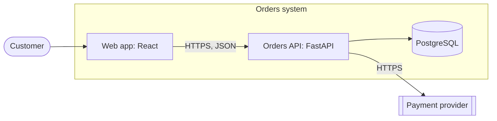

# Structure of .exo/context.md

The project profile that `project-onboarding` writes. Replace the example values with the project's real ones; delete the lines that do not apply. Every fact has its evidence (`path:line`) or is marked `(unverified)`.

~~~markdown
# Project context

## Stack

- Language: Python 3.12 (.python-version:1)
- Framework: FastAPI 0.115 (pyproject.toml:14)
- Package manager: uv (uv.lock)
- Storage: PostgreSQL 16 (docker-compose.yml:8)
- CI: GitHub Actions (.github/workflows/ci.yml)

## Commands

- Install: `uv sync`
- Test: `uv run pytest -q` (run on 2026-11-14: 212 passed, 0 failed, 38 s)
- Test one file: `uv run pytest tests/test_orders.py -q`
- Lint: `uv run ruff check .`
- Format: `uv run ruff format .`
- Build: `docker build -t orders .` (not run)

## Conventions

- TDD: strict
- Default branch: main. Branches: `<type>/<change-name>`.
- Commits: Conventional Commits (git log)
- Tests: in tests/, one file per module, named test_<module>.py (tests/)
- Errors: domain errors subclass AppError (src/errors.py:5)

## Areas

| Area | Path | What it does | Owner |
|---|---|---|---|
| API | src/api/ | HTTP endpoints | team-orders (CODEOWNERS:3) |
| Billing | src/billing/ | Invoices and totals | (unverified) |

## Architecture

- The web app calls the API through one client (src/web/api.ts:5).
- The API is the only container that talks to the database (src/db/pool.py:10).

## Modules

| Module | Path | Responsibility | Depends on |
|---|---|---|---|
| api | src/api/ | HTTP endpoints and input validation | orders, billing |
| orders | src/orders/ | Order lifecycle: create, pay, cancel | db |
| billing | src/billing/ | Invoices, totals and the payment provider | db |

## Main flows

- **Checkout:** `POST /orders` (src/api/orders.py:20) → `orders.create` (src/orders/service.py:31) → `billing.charge` (src/billing/charge.py:12) → the payment provider.
- **Cancel:** `DELETE /orders/{id}` (src/api/orders.py:58) → `orders.cancel` (src/orders/service.py:74), which refunds only paid orders.

## Integrations

| System | Kind | Where | Notes |
|---|---|---|---|
| PostgreSQL | database | src/db/pool.py:10 | Credentials from the environment (src/config.py:12) |
| Payment provider | HTTP API | src/billing/gateway.py:14 | Test keys in CI (unverified) |

## Risks

- src/billing/ handles money and has no integration tests.
- tests/test_sync.py is flaky on CI (memory 812).
- Credentials come from the environment (src/config.py:12); never hard-code them.

Last reviewed: 2026-11-14 at 3f2a9c1
~~~

## Notes

- **Stack:** languages and versions, frameworks, the package manager, storage and external services, CI.
- **Commands:** exact, copyable commands. The test command says when it was last run and with what result.
- **Conventions:** the `TDD:` line (`strict` or `not required`), branches, commits, code style, test layout, error handling.
- **Areas:** each area with its path, what it does and its owner, from `CODEOWNERS` or from the person.
- **Risks:** what can break or hurt: untested code, sensitive data, generated code, flaky tests, known incidents.
- **Last reviewed:** the last line, with the date and the short commit (`git rev-parse --short HEAD`).

## Optional sections

Architecture, Modules, Main flows and Integrations describe how the system is built. Reverse engineering fills them with evidence: `re-synthesize` (pack `discovery`) writes them from the extracted units, one section at a time and with the person's approval. A manual onboarding may leave them empty or omit them. Either way, the rules of the rest of the file hold: evidence or `(unverified)`, and no secrets or personal data.

- **Architecture:** one Mermaid diagram of the context and the containers. Outside the system go the people and the external systems; inside, what is deployed or run on its own (apps, services, databases, queues, jobs), with an arrow for each call and its protocol. Add a short list of what the diagram cannot show, with its evidence.
- **Modules:** the modules of the code, with their path, responsibility and the modules they depend on. In an adopted project they come from `.exo/discovery/structure.json` and `module-graph.mmd`; Areas stays as it is, for the owners.
- **Main flows:** the few flows that matter most (three to five), each as the chain from its entrypoint through the modules to the storage or the integration, with `path:line` at each step.
- **Integrations:** every external system: databases, queues, third-party APIs, identity providers, file stores. Say its kind, where the code uses it, and where its credentials come from, never their values.
- **Keep them short.** Link to the specs in `<specs_dir>/capabilities/` for the behavior, instead of repeating it here.
