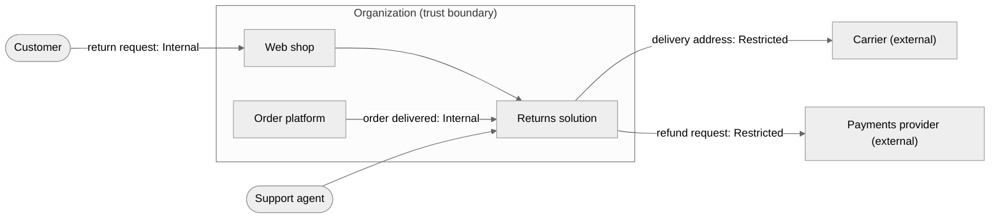

# Context and drivers

Steps 1 to 4 of `software-solution`: frame the problem, decide the regime, set the drivers and constraints, and draw the context. Everything here comes from the person, the spec or the code; what does not becomes an open question with a default.

## 1. Frame

| Question | Example |
|---|---|
| What problem does the solution solve, and for whom? | Customers cannot return delivered orders online; support handles about 900 return calls a month |
| What is in scope, and what is out? | In: returns of delivered orders. Out: exchanges, marketplace sellers' returns |
| What decision must the architecture make possible? | Where returns live, and how they talk to orders, the carrier and payments |
| How long must it last? | At least three years; the order platform is not being replaced |
| Who are the stakeholders (roles)? | Product owner of delivery, the delivery and web teams, operations, the security officer |

## 2. Regime: regulated or not

Ask the person, in one message:

1. Is the system or its data subject to a regulation or a supervisory authority (financial services, health, personal data protection law, public sector, card payments)?
2. Is it under contractual audit obligations (a customer contract, a certification the organization holds)?
3. Does it handle Restricted data (personal data) or Critical data (credentials, keys) beyond what the organization already handles elsewhere?

| Answer | Regime | What it adds |
|---|---|---|
| Yes to 1 or 2 | Regulated | The controls of `references/security-and-compliance.md`, with the evidence each produces |
| No to 1 and 2, yes to 3 | Not regulated, sensitive data | The security baseline, plus data minimization and retention |
| No to all | Not regulated | The security baseline |
| No answer, Restricted data involved | Regulated, `Assumed:` | Same as regulated, flagged for the person to confirm |

Never name a specific regulation as applying unless the person confirms it: obligations depend on the organization, the country and the contract.

## 3. Quality drivers

A driver is a quality the solution must have, written as a scenario someone can test. Pick the three to five that would change the architecture if they changed.

**Scenario shape:** source, stimulus, environment, response, measure.

| Quality | Scenario | Measure |
|---|---|---|
| Availability | The carrier's API stops answering during peak | Customers can still submit returns; labels follow within 30 minutes |
| Performance | 2,000 return requests in an hour after a sale | 95% answered within 1 second |
| Security | A customer tries to read another customer's return | Refused, and logged as a security event |
| Modifiability | A second carrier is added | No change outside the carrier adapter |
| Auditability (regulated) | An auditor asks who approved a refund and when | Answered from the audit trail within a day |
| Cost | Volume doubles | Running cost grows by less than half |
| Time to market | First release | Within one quarter |

- **Measures** come from the person or the spec. Without one, propose it and label it a proposal; a driver with no measure cannot settle a trade-off.
- **Rank them** with the person: the ranking becomes the weights of the comparison in step 6.

## Constraints

Constraints are decisions already made. They are not discussed; they shape the options.

| Kind | Examples |
|---|---|
| Technical | The organization's cloud or data center, a mandated language or runtime, an existing message broker, a database the team must use |
| Regulatory | Data residency in a region, retention periods, approvals before production changes |
| Organizational | The teams that will own each part, their skills, an operations team that runs only some technologies |
| Time and money | A date tied to a contract or an event, a budget ceiling, a license already paid for |
| Existing contracts | Public APIs that cannot break, vendor agreements, service levels promised to customers |

Write each one with its source. A "constraint" without a source is often a preference: ask.

## Assumptions

| ID | Assumption | Checked by | When |
|---|---|---|---|
| A-1 | Order events carry the delivery date | Reading the event schema (`path:line`) | Before step 7 |
| A-2 | The carrier allows 10 label requests a second | The carrier's documentation the person gives | Before the release plan |

The riskiest assumption is the one that would change the recommended option if it were false. Check it first.

## 4. Context view

The system as a box, the actors and external systems around it, the flows between them with their data level, and the trust boundaries. Use roles and kinds of systems, never real hostnames, IP addresses or URLs.

- Every arrow that carries Restricted data across the trust boundary is a question for steps 8 and 9 (an agreement, minimization, encryption).
- After the person chooses an option, draw the containers of that option the same way: one box per deployable or data store, with its owner.
