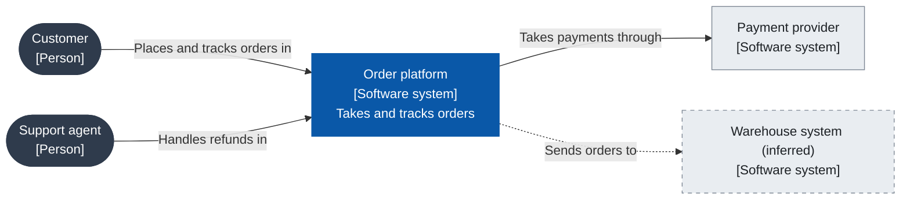
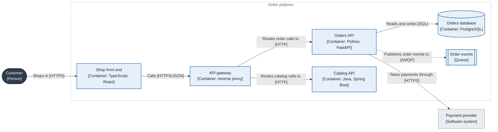
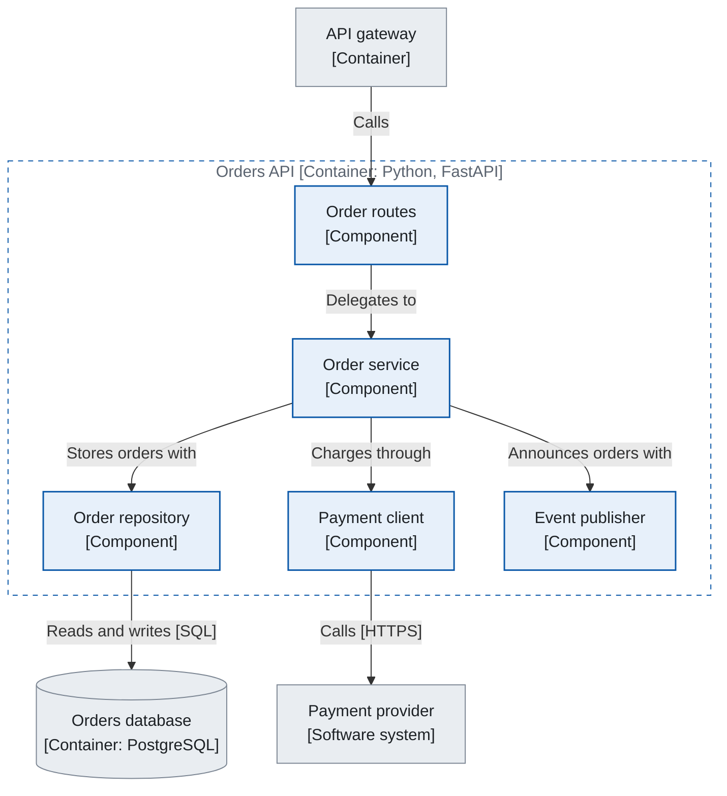
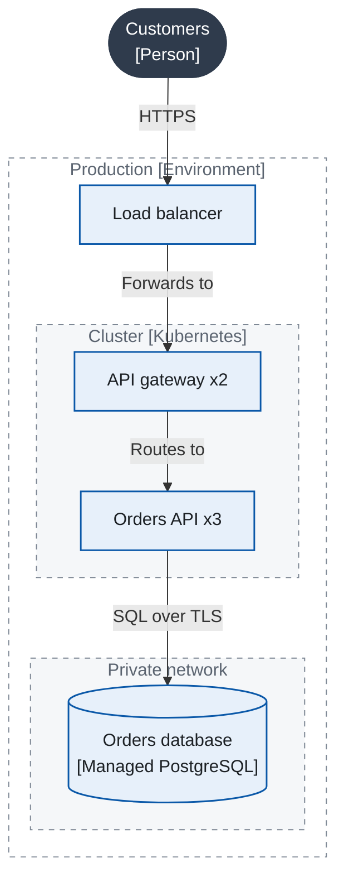

# C4 templates

Each template uses the neutral values of `.exo/shared/executive-style.md`; replace them with the brand's when `.exo/brand.json` sets them. The init line and the class definitions are in the `diagram-design` skill (its tool styling reference); they are shortened here to the class lines. Names and paths are invented.

## System context (Mermaid)



## Containers (Mermaid)



## Components of one container (Mermaid)



## Deployment (Mermaid)

Nest the deployment nodes as subgraphs, outermost first. Use generic environment and region names in any piece that may leave the team.



## The same levels in PlantUML

With the C4 library of PlantUML's standard library and the style lines of the `diagram-design` skill:

```text
@startuml
' exo-style: neutral
!include <C4/C4_Container>
title The Orders API takes orders, stores them and announces them

Person(customer, "Customer")
System_Boundary(platform, "Order platform") {
  ' [Code] services/web/package.json:5
  Container(web, "Shop front end", "TypeScript, React")
  ' [Code] services/orders/pyproject.toml:8
  Container(orders, "Orders API", "Python, FastAPI", "Takes and tracks orders")
  ' [Code] services/orders/app/db.py:9 (ORDERS_DB_URL)
  ContainerDb(ordersdb, "Orders database", "PostgreSQL")
  ' [Code] services/orders/app/events.py:12
  ContainerQueue(events, "Order events", "AMQP")
}
System_Ext(payments, "Payment provider")

Rel(customer, web, "Shops in", "HTTPS")
Rel(web, orders, "Sends orders to", "HTTPS/JSON")
Rel(orders, ordersdb, "Reads and writes", "SQL")
Rel(orders, payments, "Takes payments through", "HTTPS")
Rel(orders, events, "Publishes order events to", "AMQP")
SHOW_LEGEND()
@enduml
```

Use `C4_Context`, `C4_Component` or `C4_Deployment` for the other levels (`Deployment_Node` nests like the subgraphs above). Never include the library by URL.
