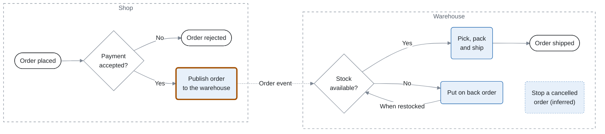

# A complete example

The request: "Diagram how an order gets to the warehouse, for the operations leads." The project has no diagrams yet and no `.exo/brand.json`. Names and paths are invented.

## 1. Decisions

- **Question:** how an order reaches the warehouse, and who acts at each step.
- **Audience:** operations leads (not developers): business words, no technology on the main path.
- **Type:** a flow with two lanes, because roles and handoffs matter. **Notation:** basic BPMN. **Tool:** Mermaid, because the repository has no diagram tool.
- **Facts:** the order states in `src/orders/service.py:40-88` and the queue consumer in `src/warehouse/consumer.py:12`. Whether a cancellation reaches the warehouse is not in the code: unconfirmed.

## 2. First use: the sample

No approval in memory and no diagram with a style marker, so the first diagram is the sample. Under it, in the answer:

> This is the first diagram in this project, so here is the style it will use: neutral (no `.exo/brand.json`). Blue for the platform in focus, gray for systems outside it, dark slate for people, one orange edge for what is new; text in the system font; all color pairs meet WCAG AA. Use this style for the diagrams and documents of this project?

After the person says yes, the convention goes to memory (`.exo/shared/executive-style.md`, section I) and the work continues.

## 3. The file: `docs/diagrams/order-flow.md`

````markdown
# Every paid order reaches the warehouse within one queue hop

Flow with lanes (basic BPMN) · as of 2026-11-17 · from the code at commit `<commit>`



**Legend:** rounded boxes are steps, diamonds are decisions, stadiums are start and end events (basic BPMN). Dashed frames: the team of each lane. Solid arrows: order of work inside a team. Dashed arrows: messages between teams. Orange edge: new in this release. Dotted box: not confirmed in the code.

Source: `src/orders/service.py`, `src/warehouse/consumer.py` · Owner: order platform team · Internal
````

## 4. The note in the answer

```markdown
**Every paid order reaches the warehouse within one queue hop** (saved in docs/diagrams/order-flow.md)

Question: how an order reaches the warehouse and who acts. Audience: operations leads.
Type: flow with two lanes, basic BPMN in a Mermaid flowchart.
Facts: src/orders/service.py:40-88 (order states), src/warehouse/consumer.py:12 (consumer).
Unconfirmed: whether cancelled orders are stopped in the warehouse (dotted); is there such a step?
Style: neutral, approved today (saved in memory). Contrast: all pairs pass.
Render: shows in the Markdown preview of the repository host. Pending a visual check: label wrapping in the warehouse lane.
```

## The same diagram for executives

For a steering committee, drop the decisions and keep the message: four boxes (Customer, Shop, Order queue, Warehouse), two labeled arrows, the queue highlighted as new, and the title "One queue now connects the shop to the warehouse". Less detail, the same names.
