# Applying the executive style in each tool

The values below are the neutral default of `.exo/shared/executive-style.md`. With `.exo/brand.json`, replace each value with the brand's value for the same token (section H of the contract) and recheck the contrast of the pairs you changed (section G).

| Token | Neutral value | Used in the snippets for |
|---|---|---|
| `ink` | `#1d2125` | text |
| `ink_muted` | `#5b6470` | connector labels, boundary labels |
| `canvas` | `#ffffff` | background, label backgrounds |
| `surface` | `#f5f7f9` | notes, zones |
| `line` | `#7d8794` | connectors, neutral edges, boundaries |
| `primary` / `on_primary` | `#0a58a8` / `#ffffff` | the focus |
| `primary_tint` | `#e7f0fa` | elements inside the focus |
| `secondary` / `on_secondary` | `#2f3b4c` / `#ffffff` | people |
| `neutral_fill` | `#e9edf1` | external systems |
| `accent` | `#a34f00` | the one highlight |

## Mermaid

Put the init line first, then the marker, then the diagram. Class definitions go at the end.

```mermaid
%%{init: {"theme": "base", "themeVariables": {"fontFamily": "system-ui, -apple-system, Segoe UI, Roboto, Helvetica Neue, Arial, sans-serif", "fontSize": "14px", "background": "#ffffff", "primaryColor": "#e7f0fa", "primaryTextColor": "#1d2125", "primaryBorderColor": "#0a58a8", "secondaryColor": "#e9edf1", "tertiaryColor": "#f5f7f9", "lineColor": "#7d8794", "textColor": "#1d2125", "edgeLabelBackground": "#ffffff", "clusterBkg": "#ffffff", "clusterBorder": "#7d8794", "titleColor": "#1d2125"}}}%%
%% exo-style: neutral
flowchart LR
    accTitle: Orders reach the warehouse through one queue
    accDescr: Customers place orders in the shop front end, which calls the Orders API. The API stores orders and publishes events to a queue that the warehouse system consumes.

    customer(["Customer<br/>[Person]"])
    subgraph platform["Order platform"]
        web("Shop front end<br/>[Container: TypeScript, React]")
        api("Orders API<br/>[Container: Python]")
        db[("Orders database<br/>[Container: PostgreSQL]")]
        queue[["Order events (new)<br/>[Queue]"]]
    end
    warehouse("Warehouse system<br/>[Software system]")

    customer -->|"Places orders using"| web
    web -->|"Sends orders to [HTTPS/JSON]"| api
    api -->|"Reads and writes"| db
    api -.->|"Publishes order events to"| queue
    queue -.->|"Delivers events to"| warehouse

    classDef focus fill:#0a58a8,stroke:#0a58a8,color:#ffffff
    classDef inner fill:#e7f0fa,stroke:#0a58a8,color:#1d2125,stroke-width:1.5px
    classDef person fill:#2f3b4c,stroke:#2f3b4c,color:#ffffff
    classDef external fill:#e9edf1,stroke:#7d8794,color:#1d2125
    classDef highlight stroke:#a34f00,stroke-width:3px
    classDef unconfirmed stroke-dasharray:1 3
    class customer person
    class web,api,db,queue inner
    class warehouse external
    class queue highlight
    style platform fill:#ffffff,stroke:#7d8794,stroke-dasharray:5 5,color:#5b6470
    linkStyle default stroke:#7d8794,stroke-width:1.5px
```



- **Shapes:** `id("…")` rounded rectangle (elements and steps, the shape of the contract), `id["…"]` rectangle, `id(["…"])` stadium (people, BPMN events), `id[("…")]` cylinder (data stores), `id[["…"]]` subroutine (queues), `id{"…"}` diamond (decisions).
- **Lines:** `-->` synchronous, `-.->` asynchronous, `==>` only for the one path the title is about. Edges: `stroke-dasharray:5 5` (dashed) only for boundaries, `stroke-dasharray:1 3` (dotted) only for what is not confirmed.
- **A second class** on the same node (`highlight`, `unconfirmed`) goes in its own `class` line.
- **Line breaks** in labels: `<br/>`. Quote every label that has brackets or punctuation.

### Sequence diagrams

Add these to `themeVariables`:

```text
"actorBkg": "#e7f0fa", "actorBorder": "#0a58a8", "actorTextColor": "#1d2125",
"actorLineColor": "#7d8794", "signalColor": "#5b6470", "signalTextColor": "#1d2125",
"noteBkgColor": "#f5f7f9", "noteBorderColor": "#7d8794", "noteTextColor": "#1d2125",
"activationBkgColor": "#e7f0fa", "activationBorderColor": "#0a58a8",
"labelBoxBkgColor": "#f5f7f9", "labelBoxBorderColor": "#7d8794", "loopTextColor": "#1d2125"
```

Use `actor` for people and `participant` for systems. To emphasize the participant in focus, wrap its messages in `rect rgb(231, 240, 250)` … `end` sparingly.

### State and class diagrams

`stateDiagram-v2` accepts the same `classDef` lines; apply them with `class <state> focus`. In `classDiagram`, set the class in focus with `style <class> fill:#0a58a8,stroke:#0a58a8,color:#ffffff` (newer Mermaid versions also accept `classDef` there). Keep the base theme variables: they color everything else.

### The C4 syntax

When the project already uses `C4Context` or `C4Container`, style with:

```text
UpdateElementStyle(api, $bgColor="#e7f0fa", $fontColor="#1d2125", $borderColor="#0a58a8")
UpdateElementStyle(warehouse, $bgColor="#e9edf1", $fontColor="#1d2125", $borderColor="#7d8794")
UpdateRelStyle(api, queue, $textColor="#5b6470", $lineColor="#7d8794")
UpdateLayoutConfig($c4ShapeInRow="3", $c4BoundaryInRow="1")
```

## PlantUML

One shared style file keeps every diagram consistent, for example `docs/diagrams/style.iuml`, included with `!include style.iuml` by relative path:

```text
' exo-style: neutral
skinparam backgroundColor #FFFFFF
skinparam defaultFontName SansSerif
skinparam defaultFontSize 14
skinparam defaultFontColor #1D2125
skinparam shadowing false
skinparam roundCorner 8
skinparam TitleFontSize 22
skinparam ArrowColor #7D8794
skinparam ArrowThickness 1.5
skinparam ArrowFontColor #5B6470
skinparam ArrowFontSize 12
skinparam ActorBackgroundColor #2F3B4C
skinparam ActorBorderColor #2F3B4C
skinparam ParticipantBackgroundColor #E7F0FA
skinparam ParticipantBorderColor #0A58A8
skinparam SequenceLifeLineBorderColor #7D8794
skinparam ClassBackgroundColor #E7F0FA
skinparam ClassBorderColor #0A58A8
skinparam StateBackgroundColor #E7F0FA
skinparam StateBorderColor #0A58A8
skinparam ActivityBackgroundColor #E7F0FA
skinparam ActivityBorderColor #0A58A8
skinparam ActivityDiamondBackgroundColor #FFFFFF
skinparam ActivityDiamondBorderColor #7D8794
skinparam UsecaseBackgroundColor #E7F0FA
skinparam UsecaseBorderColor #0A58A8
skinparam NoteBackgroundColor #F5F7F9
skinparam NoteBorderColor #7D8794
skinparam PackageBorderColor #7D8794
skinparam PackageStyle rectangle
```

With the C4 library of the standard library (`!include <C4/C4_Container>`):

```text
UpdateElementStyle("person", $bgColor="#2f3b4c", $fontColor="#ffffff", $borderColor="#2f3b4c")
UpdateElementStyle("system", $bgColor="#0a58a8", $fontColor="#ffffff", $borderColor="#0a58a8")
UpdateElementStyle("external_system", $bgColor="#e9edf1", $fontColor="#1d2125", $borderColor="#7d8794")
UpdateElementStyle("container", $bgColor="#e7f0fa", $fontColor="#1d2125", $borderColor="#0a58a8")
UpdateElementStyle("external_container", $bgColor="#e9edf1", $fontColor="#1d2125", $borderColor="#7d8794")
UpdateRelStyle($textColor="#5b6470", $lineColor="#7d8794")
AddElementTag("new", $borderColor="#a34f00")
```

## draw.io

Style strings for each role. Paste them in Edit Style, or write them in the `style` attribute of each `mxCell` in an uncompressed file. Helvetica is the editor's default sans and falls back on every system.

| Role | Style |
|---|---|
| Focus | `rounded=1;arcSize=10;whiteSpace=wrap;html=1;fillColor=#0a58a8;strokeColor=#0a58a8;fontColor=#ffffff;fontFamily=Helvetica;fontSize=14;` |
| Inside the focus | `rounded=1;arcSize=10;whiteSpace=wrap;html=1;fillColor=#e7f0fa;strokeColor=#0a58a8;strokeWidth=1.5;fontColor=#1d2125;fontFamily=Helvetica;fontSize=14;` |
| Person | `rounded=1;arcSize=40;whiteSpace=wrap;html=1;fillColor=#2f3b4c;strokeColor=#2f3b4c;fontColor=#ffffff;fontFamily=Helvetica;fontSize=14;` |
| External | `rounded=1;arcSize=10;whiteSpace=wrap;html=1;fillColor=#e9edf1;strokeColor=#7d8794;fontColor=#1d2125;fontFamily=Helvetica;fontSize=14;` |
| Data store | `shape=cylinder3;boundedLbl=1;backgroundOutline=1;size=12;whiteSpace=wrap;html=1;` plus the colors of its owner |
| Boundary | `rounded=0;dashed=1;fillColor=none;strokeColor=#7d8794;fontColor=#5b6470;verticalAlign=top;align=left;spacingLeft=8;fontSize=12;` |
| Connector, synchronous | `endArrow=block;endFill=1;strokeColor=#7d8794;strokeWidth=1.5;fontColor=#5b6470;fontSize=12;labelBackgroundColor=#ffffff;` |
| Connector, asynchronous | the synchronous style with `dashed=1;endArrow=open;endFill=0;` |
| Highlight | add `strokeColor=#a34f00;strokeWidth=3;` to the element's style |
| Unconfirmed | add `dashed=1;dashPattern=1 3;` (dotted) to the element's style; the plain dashed line is for boundaries |

## Structurizr DSL

Tag the element in focus with `Focus`, asynchronous relationships with `Async`, and new elements with `New`:

```text
// exo-style: neutral
styles {
    element "Element" {
        color #1d2125
        fontSize 22
    }
    element "Person" {
        shape Person
        background #2f3b4c
        stroke #2f3b4c
        color #ffffff
    }
    element "Software System" {
        background #e9edf1
        stroke #7d8794
    }
    element "Container" {
        background #e7f0fa
        stroke #0a58a8
    }
    element "Focus" {
        background #0a58a8
        stroke #0a58a8
        color #ffffff
    }
    element "Database" {
        shape Cylinder
    }
    element "Queue" {
        shape Pipe
    }
    element "New" {
        stroke #a34f00
        strokeWidth 6
    }
    relationship "Relationship" {
        color #5b6470
        thickness 2
        style solid
    }
    relationship "Async" {
        style dashed
    }
}
```

With a logo in `.exo/brand.json`, a `branding` block can name its repository path. Never a URL, in `branding` or `theme`.
