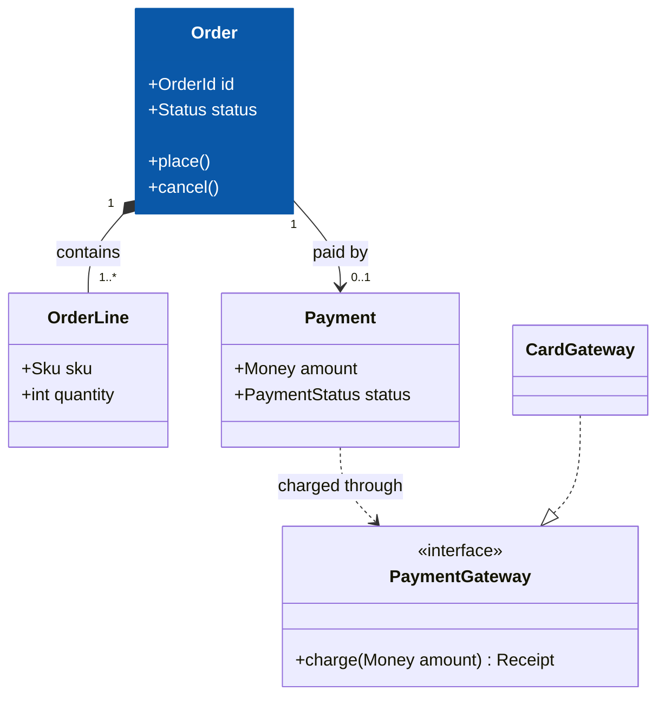
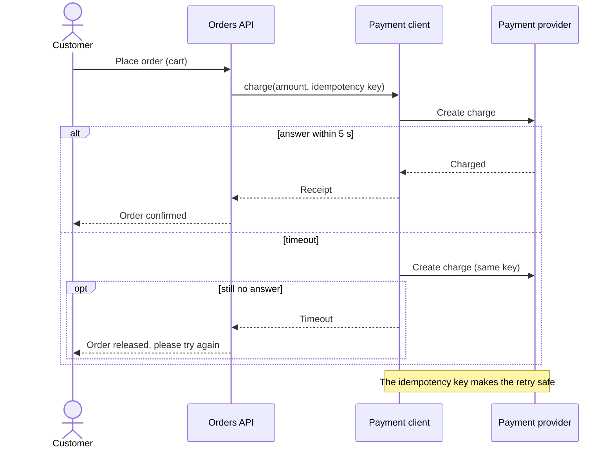
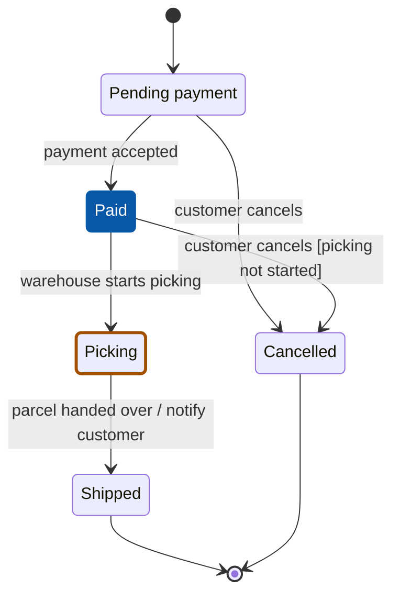
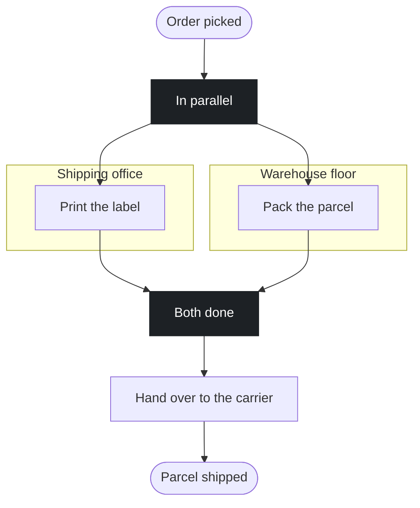
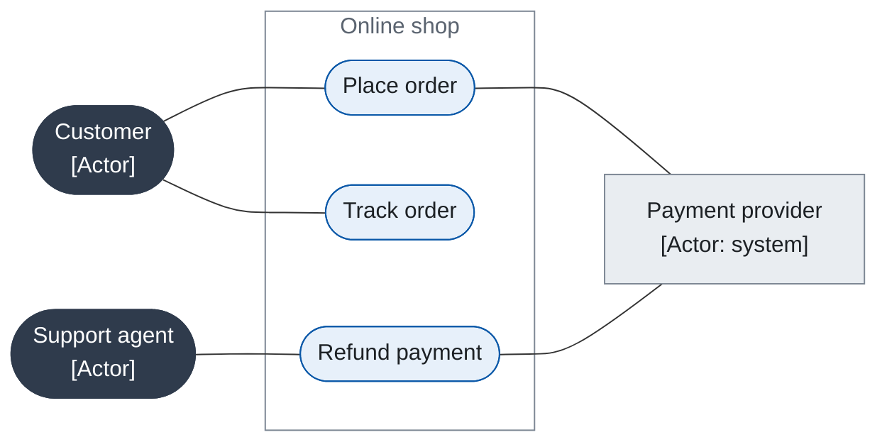

# UML in Mermaid

Start each diagram with the init line of the executive style (the `diagram-design` skill has it in its tool styling reference) and the marker `%% exo-style: neutral`, or `brand <hash>`. They are left out below to keep the examples short. Names and paths are invented.

## Class: `classDiagram`

- Relations: `<|--` inheritance, `*--` composition, `o--` aggregation, `-->` association, `..>` dependency, `..|>` realization. Multiplicity in quotes on each end, the label after a colon.
- The base theme colors every class with `primary_tint`; `style` sets the one in focus. Newer Mermaid versions also accept `classDef` in class diagrams; use it only when the project's renderer does.

## Sequence: `sequenceDiagram`

- Arrows: `->>` synchronous call, `-->>` reply, `-)` asynchronous message, `-x` a message that fails.
- `actor` draws a person; `participant` a box. `autonumber` adds step numbers when the audience will refer to them.
- Theme variables for sequences (actor fill, signal color, notes) are in the tool styling reference of the `diagram-design` skill.

## State machine: `stateDiagram-v2`

- `state "Long name" as Id` for names with spaces. Composite states: `state Open { ... }`. Fork and join: `state fork1 <<fork>>` and `state join1 <<join>>`.

## Activity: a `flowchart`

Mermaid has no activity diagram; a flowchart with lanes covers the light subset. Parallel work is a pair of narrow nodes, "In parallel" and "Both done".

The legend says: "UML activity drawn as a flowchart: black bars are fork and join." When the project has PlantUML, its activity diagrams have real fork and join bars.

## Use case: an approximation with a `flowchart`

The legend says: "Use cases approximated in a flowchart: stadiums inside the box are use cases; people and systems outside are actors."
