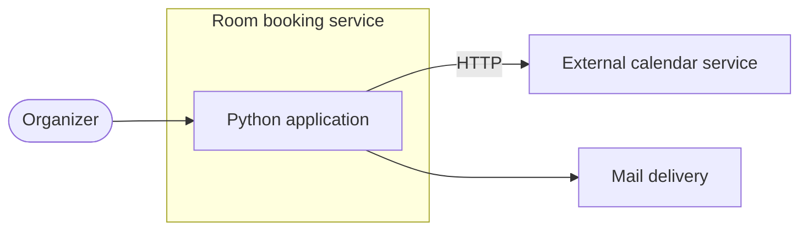

# Formats of what re-synthesize writes

The examples continue the synthetic project of `re-extract`'s example: a meeting-room booking module, unit `src-rooms`. Replace every value with the project's own.

## As-is spec

`<specs_dir>/capabilities/room-booking/spec.md`:

```markdown
# Capability: room-booking

Status: as-is
Source: exo discover; units: src-rooms

## Purpose

Organizers book meeting rooms for a few hours and cancel them before they start; every new booking is copied to an external calendar.

## Requirements

### CAP-room-booking-FR-1: Booking length

A booking ends after it starts and lasts at most 4 hours; otherwise it is rejected with a booking error. [Code] src/rooms/booking.py:28-31

#### Scenario: A booking longer than 4 hours

- Given no bookings
- When an organizer books a room for 5 hours, starting in one hour
- Then the booking is rejected [Code] tests/test_booking.py:22-24

### CAP-room-booking-FR-2: Minimum notice

A booking starts at least 15 minutes after the request. [Code] src/rooms/booking.py:10; [Code] src/rooms/booking.py:32-33

### CAP-room-booking-FR-3: No overlapping bookings

Two active bookings of the same room never overlap; a booking that ends exactly when another starts does not overlap it. [Code] src/rooms/booking.py:37-39

#### Scenario: The room is taken

- Given an active booking of a room from 10:00 to 11:00
- When another organizer books the same room from 10:30 to 12:00
- Then the booking is rejected [Code] tests/test_booking.py:16-19

### CAP-room-booking-FR-4: Active bookings per organizer

An organizer has at most 3 active bookings. Bookings that already ended still count, because nothing changes their status after the end. [Code] src/rooms/booking.py:11; [Code] src/rooms/booking.py:34-36; [Inferred: medium]

### CAP-room-booking-FR-5: Cancelling

A booking can be cancelled until it starts; after that, cancelling it is rejected. [Code] src/rooms/booking.py:47-50

### CAP-room-booking-FR-6: Calendar copy

Every new booking is copied to the external calendar with its room and its times. A failed copy is ignored, and the booking is kept. [Code] src/rooms/calendar_sync.py:12-21; [Code] src/rooms/booking.py:42

### CAP-room-booking-NFR-1: Calendar timeout

The call to the calendar service gives up after 5 seconds. [Code] src/rooms/calendar_sync.py:18
```

- FR-2, FR-4, FR-5 and FR-6 have no scenario because no test covers them: speclint warns, and R6 proposes characterization tests for them.
- FR-4 states the inferred part in its own sentence and marks it.
- A rewrite after `exo discover update` keeps these IDs. A removed FR leaves its tombstone:

```markdown
## Removed Requirements

### CAP-room-booking-FR-5: Cancelling
Removed by re-synthesis after the code changed.
Reason: cancelling moved to the scheduling service; this code no longer has it.
```

## Wiki sections

The structure of `project-onboarding`'s template wins. When the template you find has none of these sections, use these shapes, under the existing sections of `.exo/context.md`:

````markdown
## Architecture



- The calendar service is called over HTTP (src/rooms/calendar_sync.py:12-21).
- Confirmations go through the notify module (src/rooms/booking.py:43); how it delivers them is in its unit.
- No database: the caller passes the bookings in (src/rooms/booking.py:27; inferred: medium, the caller is in another unit).

## Modules

| Module | Path | Responsibility | Depends on |
|---|---|---|---|
| rooms | src/rooms/ | Books and cancels rooms; copies bookings to the calendar (units/src-rooms.md) | notify |
| notify | src/notify/ | Sends confirmations (units/src-notify.md) | - |

The import graph is in `.exo/discovery/module-graph.mmd`.

## Main flows

Book a room:
1. `create` checks the length, the notice, the organizer's limit and overlaps (src/rooms/booking.py:27-39).
2. It stores the booking and copies it to the calendar (src/rooms/booking.py:41-42).
3. It sends the confirmation (src/rooms/booking.py:43).

## Integrations

| System | What for | Configured at |
|---|---|---|
| External calendar service | A copy of every new booking | src/rooms/calendar_sync.py:6-7 (hard-coded: see the debt) |
````

- Each element of a diagram is backed by a line under it. What you inferred says so.
- Never a value from the configuration: the line where it is read.

## Recovered ADR

`<adr_dir>/0004-recovered-calendar-as-a-copy.md`, when the project has no ADR format of its own:

```markdown
# 0004. Recovered: the external calendar is a best-effort copy

Status: Recovered
Confidence: medium
Source: exo discover; units: src-rooms
Date: 2026-11-16

## Context

Bookings live in the service, and an external calendar shows them to the organizers. [Code] src/rooms/booking.py:40-43

## Decision

The service is the source of truth for bookings. The calendar receives a copy when a booking is created; a failed copy is ignored and the booking is kept. [Code] src/rooms/booking.py:42; [Code] src/rooms/calendar_sync.py:17-20

## Alternatives

Not recorded in the repository.

## Consequences

- A booking can exist without its calendar entry, and nothing retries the copy. [Inferred: high]
- Cancelling does not update the calendar. [Code] src/rooms/booking.py:47-51
```

The same four sections and header lines as the recovered ADR of `architecture-decision-record` (pack `design`), whose template wins when it is installed. What only the team can answer ("why is a missing calendar entry acceptable?") goes to `.exo/discovery/open-questions.md`, not to the ADR.

- The reasons and the alternatives come from documents or from the person, never from you.
- `NNNN` is the next free number in `adr_dir`; the file name always has `-recovered-`.

## open-questions.md

```markdown
# Open questions

What only a person can answer, from the reverse engineering of this project. They are answered in R6 (`re-adoption-plan`); an answer that changes a spec is recorded there as a correction.

## room-booking

- [ ] OQ-1: Should ended bookings stop counting toward the limit of 3 active bookings? (unit src-rooms; src/rooms/booking.py:34)
- [ ] OQ-2: Should a booking fail when its calendar copy fails? (unit src-rooms; src/rooms/booking.py:42)
- [x] OQ-3: Is the credential at src/rooms/calendar_sync.py:7 real? Answer: yes; it was rotated, and removing it is ADOPT-2.

## Unassigned

- [ ] OQ-4: Who owns the scripts folder? (inventory.json, entrypoints)
```

- One question per bullet, with `OQ-n` IDs that never change, and its source.
- A validated capability whose code changed gets its differences here, one per FR, with the new evidence.

## debt.md

```markdown
# Technical debt

Observed while reverse engineering this project. Every item cites its evidence. R6 (`re-adoption-plan`) turns the ones that block adoption into backlog items.

| ID | Debt | Evidence | Impact | Suggested action |
|---|---|---|---|---|
| DEBT-1 | A calendar credential is hard-coded | [Code] src/rooms/calendar_sync.py:7 | Anyone with the repository can use it | Remove it, rotate it, read it from the environment |
| DEBT-2 | A failed calendar copy is ignored and never retried | [Code] src/rooms/booking.py:42 | Bookings missing from the calendar | Decide the policy (OQ-2) |
| DEBT-3 | The booking rules are mostly untested | [Code] tests/test_booking.py:1-24 | Changes can break notice, limit and cancel unnoticed | Characterization tests |
```

## pending-approval.md

Only in an unattended run, for what needs the person's approval before it is written:

````markdown
# Pending approval

Proposed by re-synthesize without the person. R6 shows each entry; what the person approves is written to its target and removed from here.

## Wiki: Architecture

Target: `.exo/context.md`, section Architecture.

(the proposed section, exactly as it would be written)

## ADR: 0004-recovered-calendar-as-a-copy.md

Target: `docs/adr/0004-recovered-calendar-as-a-copy.md`.

(the proposed ADR, exactly as it would be written)
````
