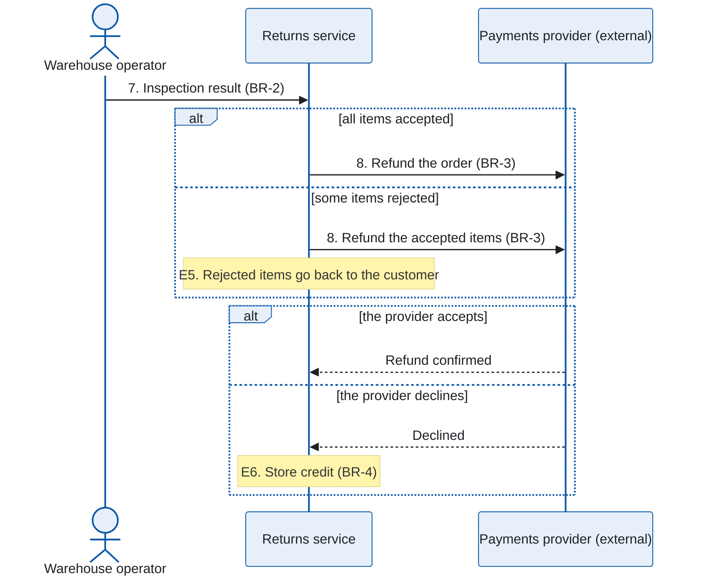
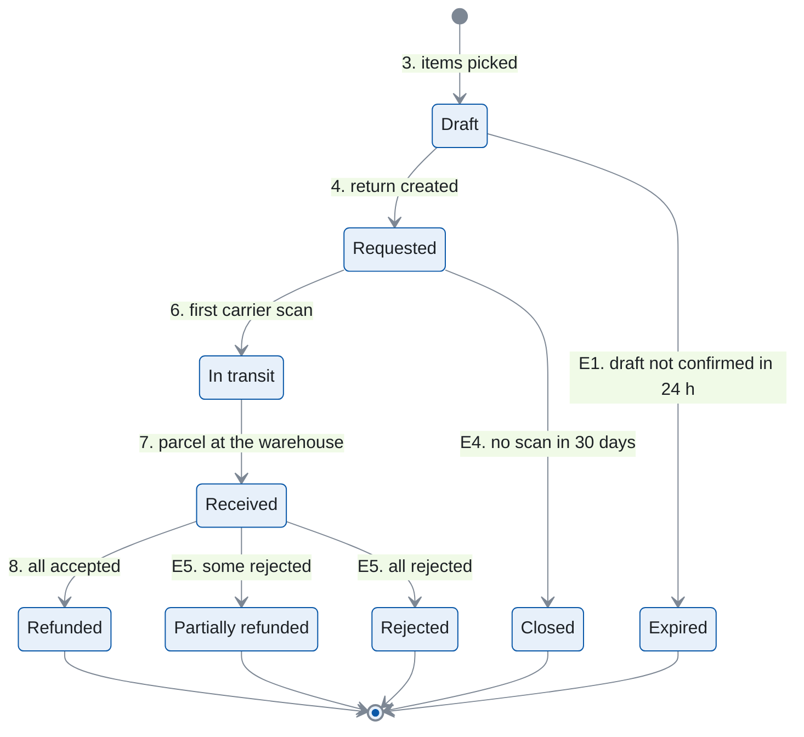

# Mermaid patterns for functional flows

Three diagram kinds cover almost every flow. Pick by what the reader needs to see, keep the IDs of the text, and check that the diagram renders where the team reads it (the repository host, the docs site, the slide tool) before delivering it.

| The reader needs to see | Use |
|---|---|
| Who does what, and where the flow branches | Flowchart with one lane per actor |
| The messages between systems, in order | Sequence diagram |
| The lifecycle of one entity | State diagram |

## Flowchart with lanes

One `subgraph` per actor, in the order they first act. Node IDs carry the text's numbers: `S3` is step 3, `D2` the decision at step 2, `E2` exception E2, and `X4` what an external actor does within step 4.

```mermaid
%%{init: {"theme": "base", "themeVariables": {"fontFamily": "system-ui, -apple-system, Segoe UI, Roboto, Helvetica Neue, Arial, sans-serif", "primaryColor": "#e7f0fa", "primaryTextColor": "#1d2125", "primaryBorderColor": "#0a58a8", "lineColor": "#7d8794", "textColor": "#1d2125", "clusterBkg": "#ffffff", "clusterBorder": "#7d8794"}}}%%
flowchart LR
  accTitle: Return a delivered order
  accDescr: The customer asks for a return and the web shop checks the window; the returns service gets a label from the carrier; after the carrier's scan and the warehouse inspection, the payments provider refunds the accepted items.

  subgraph Customer
    S1("1. Asks to return a delivered order")
    S3("3. Picks the items and a reason for each")
    S5("5. Receives the label")
    S9(["9. Receives the refund confirmation"])
  end
  subgraph WebShop["Web shop"]
    D2{"2. Within the return window? (BR-1)"}
  end
  subgraph Returns["Returns service"]
    S4("4. Creates the return, asks for a label")
    S8("8. Requests the refund (BR-3)")
  end
  subgraph Carrier["Carrier (external)"]
    X4("Issues the label")
    S6("6. Scans the parcel")
  end
  subgraph Warehouse["Warehouse operator"]
    D7{"7. Items accepted? (BR-2)"}
  end
  subgraph Payments["Payments provider (external)"]
    X8("Refunds the payment")
  end

  S1 --> D2
  D2 -- "Yes" --> S3
  D2 -. "No" .-> E2(["E2. Not returned"])
  S3 --> S4
  S3 -. "not confirmed in 24 h" .-> E1(["E1. Draft expired"])
  S4 --> X4
  X4 --> S5
  X4 -. "no answer" .-> E3("E3. Retry, then support case")
  S5 --> S6
  S5 -. "no scan in 30 days" .-> E4(["E4. Closed: not returned"])
  S6 --> D7
  D7 -- "Some or all accepted" --> S8
  D7 -. "Some or all rejected" .-> E5(["E5. Rejected items shipped back"])
  S8 --> X8
  X8 --> S9
  X8 -. "declined" .-> E6("E6. Store credit (BR-4)")

  classDef decision fill:#ffffff,stroke:#7d8794,color:#1d2125
  classDef exception fill:#ffffff,stroke:#b3261e,stroke-width:1.5px,color:#1d2125
  classDef external fill:#e9edf1,stroke:#7d8794,color:#1d2125
  classDef final fill:#ffffff,stroke:#1d2125,color:#1d2125
  class D2,D7 decision
  class E1,E2,E3,E4,E5,E6 exception
  class X4,S6,X8 external
  class S9 final
```



- `flowchart LR` reads left to right, which fits lanes; use `TB` when the steps are many and the actors few.
- Steps are rounded boxes `("...")`, decisions `{"..."}`, final states `(["..."])`; decisions, exceptions, external actors and the successful end get their classes (Style).
- A dotted edge (`-. "label" .->`) is an exception path; a solid edge is the main path.
- Steps that live in a sub-flow appear as one node with the sub-flow's name.

## Sequence diagram

For flows that are mostly messages between systems. `alt` shows a decision, `opt` an optional step, and `break` an exception that ends the flow.



## State diagram

For the lifecycle of step 7 of the skill. Every state is reachable and every state that is not final has a way out.



## Style

One model for every diagram of this skill:

- **With the `design` pack:** its contract `executive-style.md` (in `.exo/shared/`) applies in full (roles, line styles, contrast, the first-use approval and the style marker), with `.exo/brand.json` when the project has one.
- **Without it:** the neutral values of that contract, copied below, and the keys of `.exo/brand.json` in the last column, key by key. A missing key, or a value that is not a color (`#rrggbb` or `#rgb`), keeps the neutral value; say which keys came from the neutral default. Never invent brand colors or fonts.

| Token | Neutral value | Used for | `.exo/brand.json` key |
|---|---|---|---|
| `ink` | `#1d2125` | text, the border of final states | `colors.neutrals.ink` |
| `ink_muted` | `#5b6470` | edge labels | `colors.neutrals.ink_muted` |
| `canvas` | `#ffffff` | background, decisions, final states, exceptions | `colors.neutrals.canvas` |
| `line` | `#7d8794` | edges, lanes, the border of decisions and external actors | `colors.neutrals.line` |
| `primary` | `#0a58a8` | the border of steps | `colors.primary` |
| `primary_tint` | `#e7f0fa` | the fill of steps | `colors.primary_tint` |
| `neutral_fill` | `#e9edf1` | external actors | `colors.neutrals.neutral_fill` |
| `danger` | `#b3261e` | the border of exceptions, always with their `E<n>` label | `colors.status.danger` |
| `accent` | `#a34f00` | the one highlight, when there is one | `colors.accent` |
| font | `system-ui, -apple-system, Segoe UI, Roboto, Helvetica Neue, Arial, sans-serif` | all text | `typography.body` |

Every diagram starts with this init line, and a flowchart ends with these classes:

```text
%%{init: {"theme": "base", "themeVariables": {"fontFamily": "system-ui, -apple-system, Segoe UI, Roboto, Helvetica Neue, Arial, sans-serif", "primaryColor": "#e7f0fa", "primaryTextColor": "#1d2125", "primaryBorderColor": "#0a58a8", "lineColor": "#7d8794", "textColor": "#1d2125", "clusterBkg": "#ffffff", "clusterBorder": "#7d8794"}}}%%
classDef decision fill:#ffffff,stroke:#7d8794,color:#1d2125
classDef exception fill:#ffffff,stroke:#b3261e,stroke-width:1.5px,color:#1d2125
classDef external fill:#e9edf1,stroke:#7d8794,color:#1d2125
classDef final fill:#ffffff,stroke:#1d2125,color:#1d2125
```

- Color is never the only signal: exceptions are labeled `E<n>` and reached by dotted edges, external actors are labeled `(external)`, final states are stadiums.
- One accent at most. Gray carries the structure.
- Every text pair above passes WCAG AA (the contract computes them); recheck a pair a brand value changes, at 4.5:1 for text.

## Pitfalls

- **Quote every label** that has parentheses, commas, colons or a question mark: `S2["2. Check (BR-1)?"]`.
- **Node IDs** are short and without spaces (`S3`, `D2`, `E2`); the text goes in the label.
- **The word `end`** in lowercase as a node text breaks a flowchart: write `End` or `Done`.
- **Long labels:** keep them under about eight words; move the rest to the text, not to `<br/>` chains.
- **Size:** about 20 nodes per diagram. Beyond that, split by sub-flow and link the diagrams by name.
- **Accessibility:** `accTitle` and `accDescr` give screen readers a title and a one-sentence summary.
- **No real data:** labels name data by meaning ("delivery address"), never with values; no internal hostnames, URLs or IP addresses.
