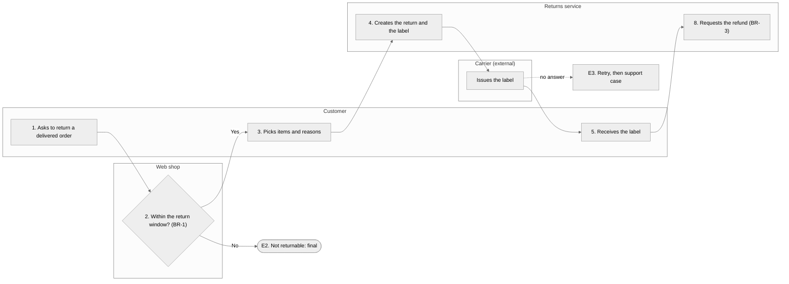
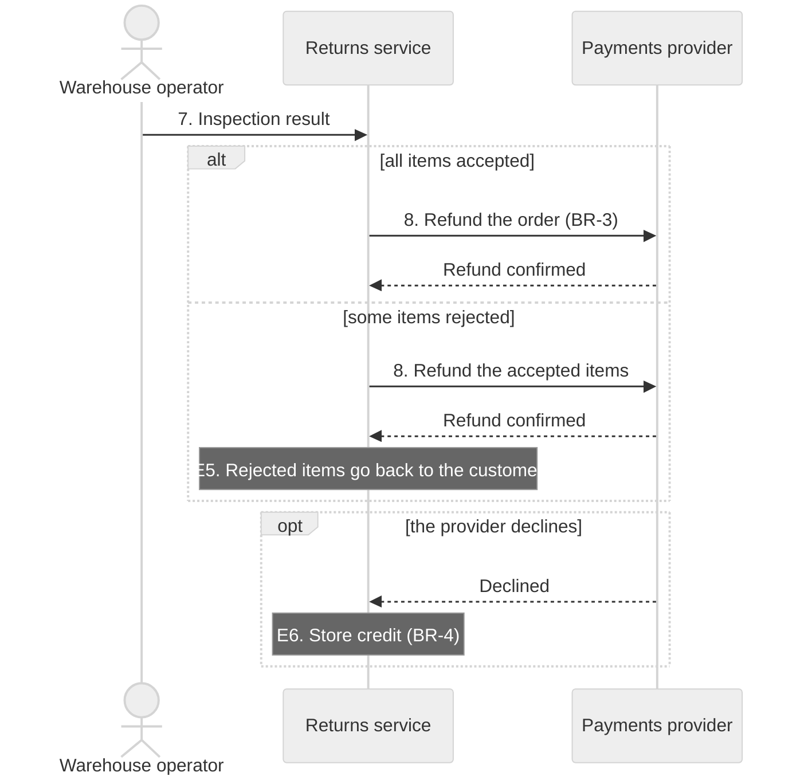
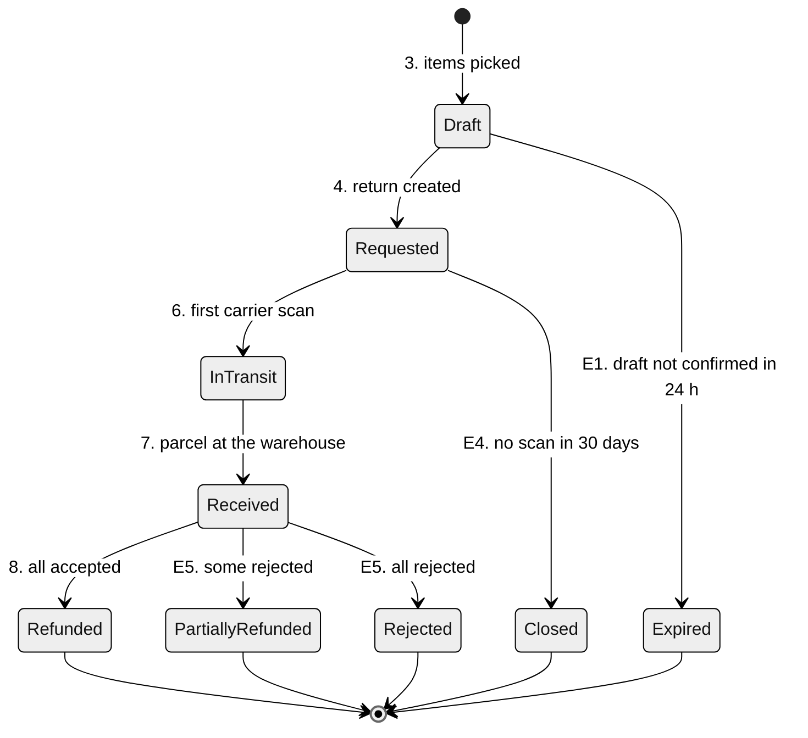

# Mermaid patterns for functional flows

Three diagram kinds cover almost every flow. Pick by what the reader needs to see, keep the IDs of the text, and check that the diagram renders where the team reads it (the repository host, the docs site, the slide tool) before delivering it.

| The reader needs to see | Use |
|---|---|
| Who does what, and where the flow branches | Flowchart with one lane per actor |
| The messages between systems, in order | Sequence diagram |
| The lifecycle of one entity | State diagram |

## Flowchart with lanes

One `subgraph` per actor, in the order they first act. Node IDs carry the text's numbers: `S3` is step 3, `D2` the decision at step 2, `E2` exception E2.



- `flowchart LR` reads left to right, which fits lanes; use `TB` when the steps are many and the actors few.
- Decisions are `{"..."}`, final states `(["..."])`, and exceptions get the `exception` class.
- A dotted edge (`-. "label" .->`) is an exception path; a solid edge is the main path.
- Steps that live in a sub-flow appear as one node with the sub-flow's name.

## Sequence diagram

For flows that are mostly messages between systems. `alt` shows a decision, `opt` an optional step, and `break` an exception that ends the flow.



## State diagram

For the lifecycle of step 7 of the skill. Every state is reachable and every state that is not final has a way out.



## Neutral style

The default when the project has no executive style: Mermaid's `neutral` theme, plus four classes. Add the `classDef` lines at the end of a flowchart.

```mermaid
flowchart LR
  classDef decision fill:#f4f4f4,stroke:#333333,stroke-width:1px
  classDef exception fill:#ffffff,stroke:#9b1c1c,stroke-width:1px,stroke-dasharray:4 2
  classDef external fill:#ffffff,stroke:#666666,stroke-dasharray:2 2
  classDef final fill:#e6e6e6,stroke:#333333
```

- Color is never the only signal: exceptions are also dashed and labeled `E<n>`, external actors are labeled `(external)`.
- One accent at most. Gray carries the structure.

## Executive style

- **With the `design` pack:** its `executive-style.md` contract says how the brand maps onto diagrams. Follow it, and take the values from `.exo/brand.json` when the project has one.
- **Without the pack, with `.exo/brand.json`:** read the keys it has. Map a primary color to the `decision` class border, a neutral or background color to the fills, and an alert color (if any) to the `exception` border. Set `themeVariables` only for keys you understood, and ask about the rest:

```mermaid
%%{init: {"theme": "base", "themeVariables": {"primaryColor": "<brand background>", "primaryTextColor": "<brand text>", "lineColor": "<brand neutral>", "fontFamily": "<brand font>"}}}%%
flowchart LR
  A["1. Step"] --> B{"2. Decision?"}
```

- **Without either:** the neutral style. Never invent brand colors or fonts.

## Pitfalls

- **Quote every label** that has parentheses, commas, colons or a question mark: `S2["2. Check (BR-1)?"]`.
- **Node IDs** are short and without spaces (`S3`, `D2`, `E2`); the text goes in the label.
- **The word `end`** in lowercase as a node text breaks a flowchart: write `End` or `Done`.
- **Long labels:** keep them under about eight words; move the rest to the text, not to `<br/>` chains.
- **Size:** about 20 nodes per diagram. Beyond that, split by sub-flow and link the diagrams by name.
- **Accessibility:** `accTitle` and `accDescr` give screen readers a title and a one-sentence summary.
- **No real data:** labels name data by meaning ("delivery address"), never with values; no internal hostnames, URLs or IP addresses.
