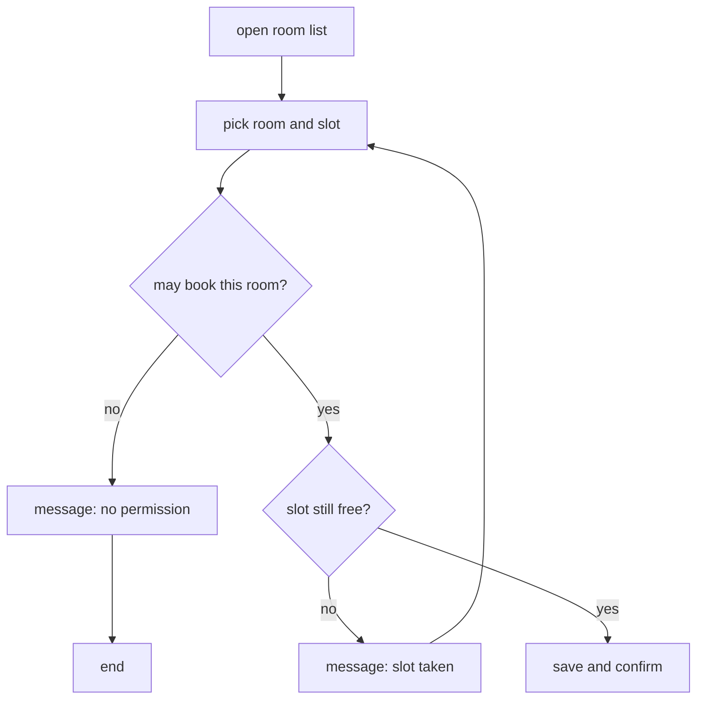

# Discovery methods

Formats and checks for each step of `product-discovery`. Use the lightest version that answers the question; a discovery for a small feature fits in one screen.

## Job to be done

**Format:** "When `<situation>`, `<user role>` wants to `<job>`, so they can `<outcome>`."

- The **situation** is the trigger: a moment, an event, a context. "When a customer calls about a late delivery", not "when using the app".
- The **job** is what they are trying to get done, without naming our solution. "Find where the parcel is", not "open the tracking screen".
- The **outcome** is how they judge success: faster, fewer mistakes, less risk, less effort.

**Around the job, note what you can back with evidence:**

| Question | Why it matters |
|---|---|
| What do they do today instead (the workaround)? | The real competitor; the baseline for the metric |
| What does the workaround cost (time, errors, money, risk)? | The size of the value |
| How often does the situation happen, and for how many users? | Whether it is worth building |
| What would make them hesitate to switch (habit, trust, training)? | Usability and adoption risks |

**Check:** if two different roles appear, write one job each and pick one for the MVP.

## Hypotheses

**Format:** "We believe `<change>` for `<user role>` will `<outcome>`. We will know when `<metric>` moves from `<baseline>` to `<target>` by `<when>`."

Sort the assumptions behind it into four kinds:

| Kind | The question | Typical evidence |
|---|---|---|
| Value | Do they want it? Will they use it? | Support requests, workarounds seen in the data, interviews the person reports |
| Usability | Can they figure it out and complete it? | Similar flows in the product, usability notes, error logs |
| Feasibility | Can we build it with this stack and team? | The code (`path:line`), a spike, existing integrations |
| Viability | Is it worth its cost, risk and maintenance? It fits legal and business limits? | The person, the proposal's constraints |

**The riskiest assumption** is the one with the least evidence and the biggest impact if wrong. Test it first, with the cheapest method that gives a real answer:

| Method | Good for |
|---|---|
| Look at existing data or logs | Value and usability, when the behavior is already observable |
| Ask a few users in the role (the person runs it) | Value, when the problem itself is in doubt |
| A clickable mock or a paper flow | Usability, before code |
| A technical spike, time-boxed | Feasibility |
| A thin slice behind a flag, to a small group | Value and usability with real use |

## Metrics

Every metric needs five things:

| Field | Example |
|---|---|
| What | Median time from opening a refund request to the decision |
| Baseline | Six minutes (support tool event log, last 30 days), or "none yet" |
| Target | Under two minutes |
| When | 30 days after release |
| Source | The support tool's event log; the event that marks the decision |

- **Primary metric:** one, tied to the job's outcome. Prefer a rate or a time per task over a raw count, which grows with traffic.
- **Leading indicators** (optional): early signs, such as first-week adoption, that tell you sooner whether the primary metric will move.
- **Guardrails:** what must not get worse: error rates, support contacts, latency, the conversion of a nearby flow, accessibility findings.
- **Common families:** adoption (share of the role that uses it), task success (share completed without help), time on task, error rate, retention (share still using it after N weeks), satisfaction (a survey score).
- **No data source yet:** the MVP includes the event or log line that measures the metric. Say which, and name no personal data in it.
- **Targets are the person's call.** Propose one with your reasoning and label it as a proposal.

## User flows

For each flow:

1. **Entry point:** where the user starts (a screen, a command, a notification, an API call).
2. **Steps:** numbered, one action or system response each.
3. **Decisions:** the branches, with the condition.
4. **Ends:** success, cancel, and each failure.

Do not forget:

- the **empty state** (nothing yet) and the **first use**;
- **invalid input**, **nothing found**, **no permission**, **timeout or service down**;
- **undo or cancel** for destructive steps;
- **what changes for other roles** (an admin, a reviewer) when this flow runs.

**Text form:**

```text
Flow: book a meeting room
1. The person opens the room list for a date.
2. They pick a room and a time slot.
3. The system checks the person may book that room.
   3a. No permission: "only <team> can book this room". End.
4. The system checks the slot is still free.
   4a. Taken meanwhile: "this slot was just booked; pick another". Back to 2.
5. The system saves the booking and shows the confirmation. End.
```

**Mermaid,** when the project renders it:



## Acceptance criteria

- **Given** sets the state before the action: data, permissions, time. **When** is one action or event. **Then** is the observable result: what the user sees, what the system stores or sends. `And` extends any of them.
- **One behavior per scenario.** Two Whens mean two scenarios.
- **Observable and testable.** "Then the booking is saved" needs a way to see it: "Then the room list shows the slot as booked by them".
- **No implementation:** no class names, tables, endpoints or CSS selectors, unless the endpoint itself is the product (a public API).
- **Concrete values** beat vague ones: "a booking from 10:00 to 11:00" beats "a short booking" when the boundary matters; add a scenario for each boundary (a booking that ends exactly when the next one starts).
- **Cover each flow branch:** the main path, each failure of the flow, and the edges the job makes likely.

Inside an SDD change, the scenarios go to `sdd-spec`, which writes them under a requirement as `#### Scenario S-n: <title>` with `- Given`, `- When`, `- Then` lines and numbers them across the delta.

## MVP scope

- **Thin slice:** one user role, one main flow, every layer it needs (input, logic, storage, output), and the measurement of the primary metric.
- **Sort the rest** with a simple rule: must have (the slice fails without it), later (valuable, not needed to test the riskiest hypothesis), not now (out of the job). Say why for each "later".
- **A walking skeleton** (the flow end to end with minimal behavior) beats a polished first layer that nobody can use yet.
- **Exit criteria:** what result of the primary metric would make the team continue, change course or stop.
- **Size check:** if the slice already looks bigger than one reviewable change (about 400 changed lines), cut it again or plan several changes; `sdd-tasks` checks the forecast later.
