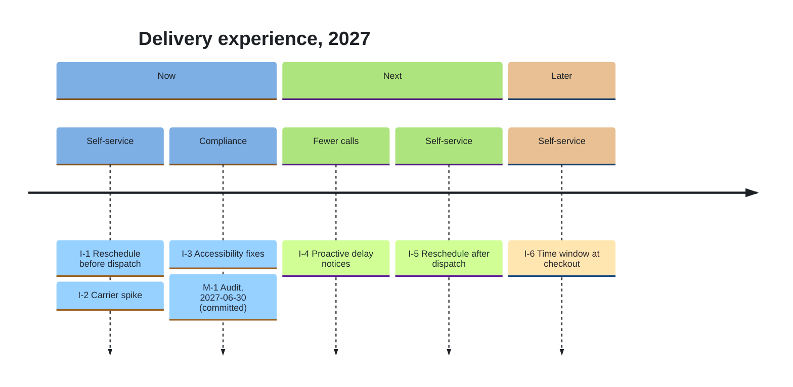
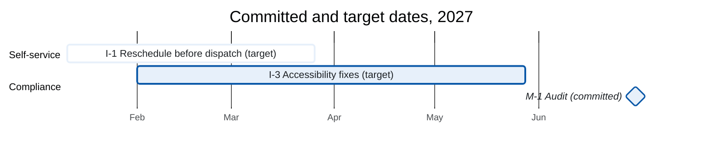

# Executive view

The one-page view of a roadmap, for an audience that has a few minutes: what we will achieve, how confident we are, what could go wrong, and what we need from them. It is derived from the detailed roadmap (`references/roadmap-model.md`), never the other way round: a card that disagrees with the detail is wrong.

## Layout

From top to bottom:

1. **Headline:** one sentence with the main outcome and its horizon. "By the end of Q3, most delivery changes happen without a call to support."
2. **Summary cards:** three to five, one per objective (or per workstream when that is how the audience thinks).
3. **Timeline:** the horizons or quarters, with the initiatives by name and the committed milestones.
4. **Top risks:** at most three, each with its mitigation in a few words.
5. **Decisions needed:** what the audience is asked to approve, choose or unblock, each with a date.
6. **Footer:** owner role, version and date, the confidence legend, "Later is not a commitment", and where the detailed roadmap lives.

## Summary cards

Each card has the same five lines, in the same order:

| Line | Content | Example |
|---|---|---|
| Title | Two or three words | Self-service |
| Objective | The outcome | Customers solve delivery changes alone |
| Target | Metric, baseline and target, with the date | 50% of reschedules self-served by Q3 (from 0%) |
| Now | The initiative in progress that moves it | Reschedule before dispatch |
| Confidence | High, medium or low, with a word on why | High: in progress, owned |

Never more than five cards. A sixth objective means the roadmap has too many; say so instead of shrinking the cards.

## Timeline in Mermaid

A `timeline` for horizons or quarters. Name the initiatives as in the detail, with their IDs, so a reader can find them:



A `gantt` only when every bar and milestone has a real date (committed or a target the person set). Label targets as such:



Check that the diagram renders where the audience will see it (the repository host, the docs site, the slide tool) before delivering it.

## Style

One model, the same as the rest of the product pack:

- **With the `design` pack:** its contract `executive-style.md` (in `.exo/shared/`) applies in full (layout, colors, typography, contrast, the first-use approval, and the quality review of `executive-visual-quality-gate`), with `.exo/brand.json` when the project has one.
- **Without it:** the neutral values of that contract, copied below, and the keys of `.exo/brand.json` in the last column, key by key. A missing key, or a value that is not a color (`#rrggbb` or `#rgb`), keeps the neutral value; say which keys came from the neutral default. The logo only from `logo.path` in the repository, on a slide or a cover, never stretched or recolored. Never invent brand colors, fonts or a logo.

| Token | Neutral value | Used for | `.exo/brand.json` key |
|---|---|---|---|
| `ink` | `#1d2125` | headline, card text | `colors.neutrals.ink` |
| `ink_muted` | `#5b6470` | footer, captions | `colors.neutrals.ink_muted` |
| `canvas` | `#ffffff` | page background | `colors.neutrals.canvas` |
| `surface` | `#f5f7f9` | card fill, table headers | `colors.neutrals.surface` |
| `line` | `#7d8794` | card borders, dividers, timeline lines | `colors.neutrals.line` |
| `primary` | `#0a58a8` | headings, the borders of timeline items | `colors.primary` |
| `primary_tint` | `#e7f0fa` | the fill of timeline items | `colors.primary_tint` |
| `accent` | `#a34f00` | the one thing that needs attention (a risk, a decision), always with a label | `colors.accent` |
| font | `system-ui, -apple-system, Segoe UI, Roboto, Helvetica Neue, Arial, sans-serif` | all text | `typography.body`; the headline, `typography.heading` |

Mermaid diagrams start with the init line of the examples above, with these values or the brand's.

- One sans-serif font family, three sizes at most (headline, card title, body).
- Generous white space; aligned cards of equal size; no shadows, gradients or 3D.
- Confidence shown with words (high, medium, low), optionally with a filled, half or empty marker.
- Every text pair above passes WCAG AA (the contract computes them); recheck a pair a brand value changes, at 4.5:1 for text.

## Visual brief

When the team builds the page in a slide or design tool, give a brief instead of (or with) the Mermaid diagram. It describes the page so anyone, or a design skill, can build it without guessing:

```markdown
# Visual brief: <roadmap name>, executive view

- Format: one slide, 16:9 (or one A4 page, landscape)
- Style: <executive-style.md of the design pack | its neutral values (Style above)>, with .exo/brand.json when it exists
- Headline (top, largest text): "<headline>"
- Cards (one row, equal width, left to right):
  1. <title> | <objective> | <target> | Now: <initiative> | Confidence: <level>
  2. ...
- Timeline (middle, full width): columns Now | Next | Later; rows <workstreams>;
  items as labeled boxes with their IDs; committed milestones as diamonds with the date
- Risks (bottom left, up to three lines): <R-1 in a few words>; ...
- Decisions needed (bottom right): <decision, by date>; ...
- Footer (smallest text): <owner role> · v<n>, <date> · Confidence: high / medium / low · Later is not a commitment · Detail: <path>
- Do not include: internal hostnames, people's names, customer names, unconfirmed dates
```

## Quality checks

Run them before the view reaches its audience. They are the inline criteria when `executive-visual-quality-gate` (pack `design`) is not installed:

1. **One message:** the headline says the main outcome; someone who reads only it knows what the year is about.
2. **Glanceable:** the cards and the timeline read in under a minute; no paragraph longer than two lines.
3. **Consistent with the detail:** every card, initiative, ID, date and confidence matches the detailed roadmap.
4. **Honest dates:** every date is a milestone labeled committed (with its source) or target; Later has none.
5. **Plain words:** no internal jargon or acronyms the audience does not use; outcomes, not system names.
6. **Accessible:** text contrast of at least 4.5:1 against its background, meaning never carried by color alone, readable when printed in grayscale.
7. **Clean:** no personal names, customer names, internal hostnames, URLs or secrets (for an external audience, also no internal risks or capacity).
8. **Footer complete:** owner role, version, date, confidence legend, and where the detail lives.

Report each check as passed or failed with the fix; fix the failures before delivering.
