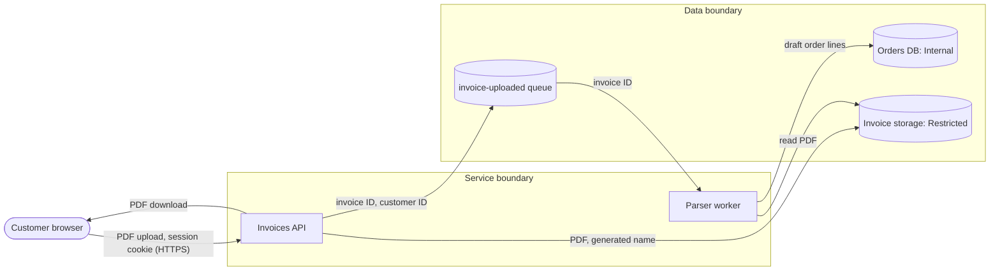

# Threat model example

A complete, synthetic example for a Tier 3 change: customers upload supplier invoices as PDF, a worker parses them, and the parsed lines become draft orders. It shows the section of design.md and the gate file. Every name, path and host is invented.

## design.md, Risks & Mitigations

````markdown
## Risks & Mitigations

### Threat model

**Scope:** the upload endpoint, the parser worker and the draft orders it creates. The existing order approval flow is out of the model: it does not change.

**Assets:**
- Invoice files: Restricted (supplier contacts and bank details of real people).
- Draft orders: Internal.
- Object storage credentials of the worker: Critical (read from the secret manager, never logged).
- Availability of the parser queue: orders stop when it stalls.

**Entry points:**
- POST /invoices: authenticated customers upload a PDF (internet → service).
- GET /invoices/{id}: authenticated customers download their invoice (internet → service).
- The parser worker consumes `invoice-uploaded` messages (queue → worker).

**Trust boundaries:** internet → API; API → object storage; queue → worker; worker → orders database.

**Data flow:**



| ID | STRIDE | Element | Threat | Likelihood | Impact | Mitigation | Residual |
|---|---|---|---|---|---|---|---|
| TM-1 | Information disclosure | GET /invoices/{id} | A customer reads another customer's invoice by changing the ID | High | High | Query by invoice ID and the session's customer ID (SCB-3); test_rejects_other_customers_invoice | Low |
| TM-2 | Denial of service | Parser worker | A crafted PDF (decompression bomb, thousands of pages) exhausts memory and stalls the queue | Medium | Medium | 10 MB upload limit, 50-page limit, parser timeout of 30 s, message sent to a dead-letter queue on failure (SCB-1); test_rejects_oversized_pdf, test_parser_times_out | Medium |
| TM-3 | Tampering | POST /invoices | The upload is an executable or HTML file renamed to .pdf and is later served inline to another user | Medium | High | Check the content type from the file's bytes, store under a generated name, serve with `Content-Disposition: attachment` (SCB-1); test_rejects_non_pdf_content | Low |
| TM-4 | Spoofing | Parser worker | A message with a forged customer ID makes the worker attach lines to another customer's orders | Low | High | The worker reads the customer ID from the stored invoice record, not from the message (SCB-3); test_worker_ignores_message_customer_id | Low |
| TM-5 | Information disclosure | Parser worker logs | Parse errors log the extracted text, which includes supplier bank details | Medium | High | Log the invoice ID and the error type only (SCB-6); test_parse_error_log_has_no_content | Low |
| TM-6 | Repudiation | Draft orders | A customer denies having uploaded the invoice behind a disputed order | Low | Medium | Audit entry with customer ID, invoice ID and time on upload (SCB-6) | Low |

**Abuse cases:**
- As a customer, I change the invoice ID in the download URL to collect other customers' invoices (TM-1).
- As an attacker with a free account, I upload a decompression-bomb PDF in a loop to stop invoice processing for everyone (TM-2).
- As a customer, I upload an HTML page renamed to .pdf and send its link to an operator so it runs in their session (TM-3).
- As someone with access to the queue, I publish a message with another customer's ID to pollute their orders (TM-4).

Residual risk TM-2 (Medium): a slow but valid PDF can still delay the queue for up to 30 s per file; the queue alerts after 5 minutes of backlog. Needs the tech_lead's acceptance.
````

## gates/threat_model.md

```markdown
# Gate: threat_model

<!-- exo-gate:threat_model -->

## Verdict

APPROVED: six threats, each mitigated in the plan; TM-2 keeps a Medium residual risk for the tech_lead to accept.

## Findings

| Severity | File:line | Finding | Rule/OWASP |
|---|---|---|---|
| Low | src/invoices/api.py:34 | TM-1: cross-customer download by ID; owner filter and its test | Information disclosure, A01:2021, CWE-639 |
| Medium | src/invoices/parser.py (planned) | TM-2: memory exhaustion with a crafted PDF; size, page and time limits, a slow file can still delay the queue | Denial of service, CWE-400 |
| Low | src/invoices/api.py:52 | TM-3: non-PDF content served inline; content check, generated name, download disposition | Tampering, A04:2021, CWE-434 |
| Low | src/invoices/worker.py (planned) | TM-4: forged customer ID in the message; worker reads it from the stored record | Spoofing, A07:2021, CWE-345 |
| Low | src/invoices/worker.py (planned) | TM-5: invoice content in error logs; log ID and error type only | Information disclosure, A09:2021, CWE-532 |
| Low | src/invoices/api.py:60 | TM-6: no proof of upload; audit entry on upload | Repudiation, A09:2021, CWE-778 |

## Approval

Requires tech_lead approval: yes
Source: skill threat-modeling
```

`yes` because TM-2 keeps a Medium residual risk. If the plan had no mitigation for TM-1, the verdict would be `ESCALATED`: a High residual risk.
