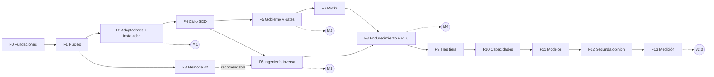

# Plan de construcción del motor `arnes` — Leeme primero

> **Nombre definitivo: `exo`** (D-01 → `docs/adr/0001-nombre-y-layout.md`, 2026-10-29). El plan conserva el texto original. Donde dice `arnes`, `.arnes/`, `ARNES_` o `arnes-`, leé `exo`, `.exo/`, `EXO_` y `exo-`. El código toma todos esos nombres de `src/exo/_meta.py`.

Este plan describe cómo construir, en un repositorio nuevo, un **motor de desarrollo gobernado por proyecto**, agnóstico del agente de IA, tomando como base el reporte transcripto *"ARNÉS — Reporte técnico del sistema de referencia"* y sumando tres mejoras: agnosticismo con instalación de un comando, ingeniería inversa de proyectos existentes y memoria híbrida (léxica + vectorial).

`arnes` es un **nombre de trabajo** (ver D-01 en `04-DECISIONES.md`). Todo nombre visible (CLI, carpeta `.arnes/`, prefijo de variables `ARNES_`) sale de una única constante en el código, así que renombrar después es barato.

## Archivos del plan

| Archivo | Para qué sirve |
|---|---|
| `00-LEEME-PRIMERO.md` | Este archivo: cómo usar el plan, fases, hitos, reglas de juego |
| `01-VISION-Y-ALCANCE.md` | Qué construimos, qué se conserva del reporte, qué cambia, qué se descarta, definición de éxito |
| `02-ARQUITECTURA.md` | Arquitectura objetivo: fuente canónica + adaptadores, layout del repo y del proyecto instalado, config, invariantes |
| `03-MATRIZ-AGENTES.md` | Qué archivos lee cada agente (Claude Code, Copilot, Cursor, Codex, Gemini, Windsurf/Devin) y cómo los generamos |
| `04-DECISIONES.md` | Dudas abiertas, cada una con opción recomendada por defecto y qué fase bloquea |
| `fases/F0…F8` | Una fase por archivo: objetivo, alcance, entregables, tareas en orden, criterios de aceptación |
| `paquete-capacidades.md` y `fases/F9…F13` | Paquete posterior a la v1.0: tres tiers, catálogo de capacidades, modelo por tier, segunda opinión y medición (D-52 a D-55) |
| `99-TRAZABILIDAD.md` | Cada pieza del reporte (incluidas las 100 skills) mapeada a una fase o marcada como descartada |
| `PROGRESO.md` | Plantilla de seguimiento que Claude Code actualiza al cerrar cada fase |
| `repo-raiz/AGENTS.md` y `repo-raiz/CLAUDE.md` | Reglas de desarrollo para la raíz del repo nuevo |

## Cómo usarlo con Claude Code

1. Crear una carpeta vacía para el repo nuevo y hacer `git init`.
2. Copiar este plan a `docs/plan/` y la transcripción completa del reporte (los 16 `.md` del proyecto actual) a `docs/referencia/`.
3. Copiar `repo-raiz/AGENTS.md` y `repo-raiz/CLAUDE.md` a la raíz del repo.
4. Revisar `04-DECISIONES.md`. Las marcadas **BLOQUEA F0** tienen que estar confirmadas o aceptadas con su default antes de arrancar.
5. Trabajar **una fase por rama**. Claude Code arranca cada fase en *plan mode*, lee el archivo de la fase, propone la secuencia de commits, vos la aprobás y recién ahí implementa (tests primero).
6. Una fase se cierra cuando **todos** sus criterios de aceptación pasan con el comando exacto y el resultado queda anotado en `docs/plan/PROGRESO.md`. No se arranca la fase siguiente con criterios en rojo.
7. Si aparece una duda que cambia el diseño, se agrega como nueva `D-xx` en `04-DECISIONES.md` y se frena esa parte. No se improvisa.

### Prompt sugerido para arrancar cada fase

```text
Leé CLAUDE.md, docs/plan/00-LEEME-PRIMERO.md, docs/plan/02-ARQUITECTURA.md,
docs/plan/04-DECISIONES.md y docs/plan/fases/F<n>-*.md.
Entrá en plan mode y proponé la secuencia de commits para la fase F<n>,
respetando el orden de tareas y los criterios de aceptación.
No implementes nada fuera del alcance de esta fase.
Cuando apruebe el plan, implementá con tests primero. Al terminar, corré
cada criterio de aceptación con el comando exacto, reportá el resultado
y actualizá docs/plan/PROGRESO.md.
```

## Mapa de fases

| Fase | Objetivo | Depende de | Hito al cerrar |
|---|---|---|---|
| F0 | Fundaciones del repo y verificación de convenciones de agentes | — | — |
| F1 | Núcleo determinista (runtime stdlib: config, filemerge, snapshots, fitness, speclint, validador, MCP base) | F0 | — |
| F2 | Adaptadores multi-agente e instalador de un comando | F1 | **M1: se instala en cualquier agente** |
| F3 | Memoria v2: engram portado + búsqueda híbrida + experimento | F1 | — |
| F4 | Ciclo SDD completo con specs vivas | F2 | — |
| F5 | Gobierno, seguridad y gates (con enforcement por git hooks y CI) | F4 | **M2: v0.1 usable en un proyecto nuevo** |
| F6 | Ingeniería inversa y adopción de proyectos existentes | F4 (F3 recomendable) | **M3: adopta proyectos existentes** |
| F7 | Packs de stack y resto del catálogo de skills | F5 | — |
| F8 | Endurecimiento, evals con agentes reales y distribución | F6, F7 | **M4: v1.0** |
| F9 | Tres tiers en lugar de cuatro, con migración (D-52) | F8 | — |
| F10 | Catálogo de capacidades por agente y perfil por máquina (D-53) | F9 | — |
| F11 | Modelo por tier y por rol (D-54) | F10 | — |
| F12 | Puntos de decisión y segunda opinión (D-55) | F11 | — |
| F13 | Medición y ajuste de los defaults | F12 | **v2.0** |

F3 es independiente de F2 y F4: se puede hacer en paralelo (otra rama u otra sesión) si conviene.

F9 a F13 son el paquete de capacidades y tiers (`paquete-capacidades.md`), posterior a la v1.0. Van en serie y terminan en la versión 2.0.0, porque pasar de cuatro tiers a tres es incompatible con lo publicado.



## Relación con el reporte

El reporte describe un sistema que existe en otra máquina, pero sus apéndices A–F (frontmatter verbatim, `AGENTS.md`, `inputSchema` de las tools, firmas del runtime) no se fotografiaron y el repo original no está disponible. Por eso esto es una **reconstrucción por contratos** (el "camino B" del capítulo 11 del reporte) con rediseño:

- Donde el reporte da el contrato completo (reglas FM de fitness, las 11 invariantes del runtime, estructura de artefactos SDD, envelope de fases, matriz DPA, catálogo de tools MCP, reglas del validador), **se respeta**.
- Donde el reporte solo da nombres y descripciones recortadas (cuerpos de skills, plantillas, textos de contratos `_shared/`), **se diseña de nuevo** siguiendo el rol descripto.
- Si el plan y el reporte se contradicen, **gana el plan**. El reporte es referencia, no especificación.

`99-TRAZABILIDAD.md` muestra que nada del reporte quedó afuera sin una decisión explícita.
