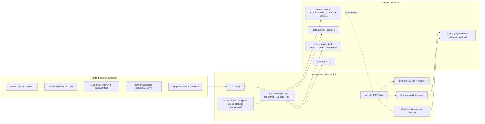

# 02 — Arquitectura objetivo

## 2.1 Vista general

El motor tiene tres capas. La **fuente canónica** (`content/` en el repo del motor) contiene reglas, skills, subagentes, contratos compartidos y plantillas, escritos una sola vez y en formatos abiertos. El **runtime** (`src/arnes/`) es un CLI y un servidor MCP que resuelve qué packs instalar, consulta a cada **adaptador** qué archivos necesita su agente y aplica esas escrituras de forma atómica, idempotente y reversible. Dentro del proyecto, el agente lee sus archivos nativos y habla con el servidor MCP para memoria, observabilidad e ingeniería inversa. Los git hooks y `arnes check` hacen cumplir lo que no puede quedar librado al agente.



## 2.2 Layout del repo del motor

```text
arnes/                              # raíz del repo del motor
├── AGENTS.md                       # reglas de desarrollo del motor (cualquier agente)
├── CLAUDE.md                       # @AGENTS.md + notas solo de Claude Code
├── pyproject.toml                  # sin dependencias de runtime; extras [vector], [dev]
├── install.sh  install.ps1         # instaladores de un comando (F2)
├── src/arnes/
│   ├── _meta.py                    # NAME, DIR (".arnes"), ENV_PREFIX ("ARNES_"), VERSION
│   ├── __main__.py  cli.py
│   ├── core/                       # fsutil, frontmatter, config, filemerge, structmerge, lock, snapshots
│   ├── packs/                      # manifiestos, resolución de dependencias, descubrimiento de skills
│   ├── adapters/                   # base, detect, generic, claude_code, copilot, cursor, codex, gemini, windsurf_devin
│   ├── installer/                  # motor de operaciones, init/sync/uninstall, wizard, curate
│   ├── memory/                     # store, lexical, hybrid, guard (S1), embeddings/, backends/
│   ├── sdd/                        # fitness, speclint, observability, specs (deltas), check, templates/
│   ├── discovery/                  # inventory, stack, graph, git_metrics, planner, state, sampler, coverage
│   ├── governance/                 # githooks, gates, p0
│   ├── mcp/                        # server (JSON-RPC stdio) + tools/
│   └── doctor.py
├── content/
│   ├── rules/AGENTS.base.md        # reglas always-on (≤ 60 líneas)
│   ├── packs/<pack>/pack.json
│   ├── packs/<pack>/skills/<skill>/SKILL.md (+ references/, assets/, scripts/)
│   ├── packs/<pack>/agents/<subagente>.md
│   ├── shared/                     # contratos (ex _shared/), esquemas JSON, matriz DPA
│   ├── templates/                  # artefactos SDD, CODEOWNERS, PR
│   ├── ci/                         # plantillas GitHub Actions / GitLab CI
│   └── githooks/                   # commit-msg, pre-commit, pre-push
├── tests/                          # unit, golden/ (adaptadores), fixtures/repos/, memory_eval/
└── docs/                           # plan/, referencia/, adr/, agent-matrix.md, evals/
```

## 2.3 Layout de un proyecto con el motor instalado

```text
<proyecto>/
├── AGENTS.md                       # bloque <!-- BEGIN:arnes:core --> inyectado; el resto es del humano
├── CLAUDE.md                       # solo si Claude Code es destino: bloque con @AGENTS.md
├── .agents/skills/<skill>/         # copia canónica de las skills instaladas (versionada)
├── .claude/skills/<skill>/         # espejo, solo si Claude Code es destino
├── .claude/agents/*.md             # subagentes (también los leen VS Code y Cursor; ver matriz)
├── .github/agents/*.agent.md       # solo si Copilot es destino
├── .mcp.json | .vscode/mcp.json | .cursor/mcp.json | .codex/config.toml | .gemini/settings.json
├── .arnes/
│   ├── config.json                 # config del proyecto (ex .devin/config.json)
│   ├── lock.json                   # archivos generados, hashes, versión del motor
│   ├── context.md                  # wiki del proyecto (ex .sdd/context.md)
│   ├── skill-registry.md
│   ├── shared/                     # contratos que leen las skills (ex _shared/)
│   ├── githooks/                   # hooks versionados (core.hooksPath)
│   ├── discovery/                  # salidas de ingeniería inversa
│   └── backups/                    # snapshots tar.gz (no versionado)
└── specs/
    ├── capabilities/<capacidad>/spec.md   # specs vivas, fuente de verdad del comportamiento
    ├── [<epic>/]<change-name>/            # change-root: proposal, spec (delta), design, tasks, ...
    └── archive/[<epic>/]YYYY-MM-DD-<change-name>/
```

Los contratos compartidos se instalan en `.arnes/shared/` y no dentro de un directorio de skills. Así no se duplican en los espejos y ningún agente los confunde con una skill. Las skills los citan por ruta (`.arnes/shared/sdd-phase-common.md`).

## 2.4 Componentes del runtime

| Módulo | Responsabilidad | Origen en el reporte |
|---|---|---|
| `core/fsutil.py` | Escritura atómica (tmp + `os.replace`), SHA256, saneo de rutas (sin `..`, sin unidad, sin absolutas) | Invariantes 2, 3 (§4.6) |
| `core/frontmatter.py` | Parser de un subconjunto de YAML sin PyYAML | `registry.py` (§4.1) |
| `core/config.py` | `.arnes/config.json`: defaults silenciosos, saneo, migraciones de esquema | `config.py` (§4.1, §4.7) |
| `core/filemerge.py` | Bloques marcados `BEGIN/END:arnes:<id>` con estilos de comentario HTML y `#` | `filemerge.py` (§4.1) |
| `core/structmerge.py` | Merge por clave en JSON (p. ej. `mcpServers.arnes`) sin tocar el resto | Nuevo |
| `core/lock.py` | Registro de archivos generados, dueño, hash, detección de cambios manuales | Nuevo |
| `core/snapshots.py` | tar.gz deterministas, deduplicados, poda con pins, extracción segura | `installer.py` (§4.5, invariante 10) |
| `packs/` | Manifiestos, dependencias (orden topológico), descubrimiento de skills | Manifests de plugins (§2.3) |
| `adapters/` | Un adaptador por agente; detección y cálculo de operaciones | Nuevo (reemplaza `git-subdir`) |
| `installer/` | Motor de operaciones, `init`, `sync`, `add-agent`, `uninstall`, wizard, `curate` | `installer.py`, `curate.py` |
| `memory/` | Store con backends, guard S1, sesiones, proyectos, export/import, embeddings | `engram.py` (§5.5) |
| `sdd/` | Fitness, speclint, observabilidad, deltas de specs, `check` | `fitness.py`, `speclint.py`, `observability.py` |
| `discovery/` | Inventario, grafo de módulos, métricas de git, planificador, estado, muestreo | Nuevo |
| `governance/` | Git hooks, gates, `p0` | `_verify_p0.py` + nuevo |
| `mcp/` | Servidor JSON-RPC 2.0 por stdio y registro de tools | `mcp_server.py` (§5.2) |
| `doctor.py` | Diagnóstico de entorno, agentes, memoria, disco | `doctor.py` (§4.1) |

## 2.5 Packs (antes plugins)

Cada pack tiene `content/packs/<pack>/pack.json`:

```json
{
  "name": "sdd",
  "version": "0.1.0",
  "description": "Desarrollo guiado por especificaciones...",
  "requires": ["core"],
  "optional": ["quality", "security", "frontend", "java"]
}
```

`requires` se instala en cascada; `optional` habilita referencias a skills de ese pack sin instalarlo (misma semántica que `requiredPlugins`/`optionalPlugins`, §2.3 del reporte). Los nombres de skill son únicos en toda la colección. Una skill referencia a otra como `skill:<nombre>`; si el pack no está instalado, aplica el criterio inline y lo declara con el texto `"<pack> no instalado — aplicando criterio inline"`.

Packs previstos: `core`, `sdd`, `quality`, `security`, `discovery` (nuevo), `design`, `frontend`, `java`, `python`, `ops`, `product`, `agentic`.

## 2.6 Formato canónico de una skill

Se usa **solo** el frontmatter del estándar Agent Skills, para que la misma carpeta funcione en todos los agentes. Todo lo propio del motor va dentro de `metadata` con prefijo `arnes-`.

```markdown
---
name: sdd-verify
description: >-
  Verifica que la implementación cumple spec y diseño, en contexto fresco...
  Usala cuando ... / Use when ...
metadata:
  arnes-pack: sdd
  arnes-execution: subagent        # subagent | inline
  arnes-subagent: sdd-verifier     # qué subagente canónico la corre
  arnes-phase: verify
  arnes-permissions: read-only+tests
---

# sdd-verify
...cuerpo...
```

Reglas: `name` igual al nombre de la carpeta (minúsculas, dígitos y guiones, hasta 64 caracteres), `description` de hasta 1024 caracteres con disparadores explícitos (en español e inglés), cuerpo de hasta 500 líneas con divulgación progresiva hacia `references/`. Los campos del reporte que no son del estándar (`triggers`, `permissions`, `subagent`, `origin`, `argument-hint`) se traducen a `metadata` o al cuerpo. El validador rechaza escapes Unicode literales como `\u00f1` (ver inconsistencia 9 del reporte).

## 2.7 Formato canónico de un subagente

`content/packs/<pack>/agents/<nombre>.md` usa el formato Markdown + frontmatter de los subagentes de Claude Code (`name`, `description`, `tools`, `model` opcional), porque varios agentes lo leen directamente (ver `03-MATRIZ-AGENTES.md`). Los adaptadores lo traducen para los que necesitan otro formato (`.github/agents/*.agent.md`, TOML de Codex). Subagentes canónicos del ciclo: `sdd-explorer` (solo lectura), `sdd-implementer` (escribe dentro del plan congelado), `sdd-verifier` (solo lectura + correr tests, contexto fresco) y `sdd-judge` (solo lectura). F6 agrega `re-extractor` y `re-auditor`.

## 2.8 Adaptadores

Un adaptador es **puro**: no escribe nada, solo calcula operaciones. Toda escritura pasa por el motor común.

```python
class AgentAdapter(Protocol):
    id: str                                   # "claude-code", "copilot", "cursor", ...
    tier: Literal[1, 2, 3]                    # 1 = soporte completo, 2 = reglas+skills+MCP, 3 = genérico
    def detect(self, project: Path, env: Mapping[str, str]) -> Detection: ...   # puntaje + evidencias
    def capabilities(self) -> Capabilities: ...  # rules, skills, subagents, mcp, hooks, commands
    def plan(self, bundle: CanonicalBundle, project: Path, scope: Scope) -> list[FileOp]: ...

# FileOp: WriteFile | MergeBlock | MergeKey | MirrorDir | Remove, cada una con el hash esperado
```

El motor calcula las operaciones de todos los adaptadores elegidos, las compara con `.arnes/lock.json`, y si no hay diferencias no hace nada (ni escribe ni crea snapshot). Si hay diferencias, toma un snapshot de las rutas afectadas, aplica las escrituras de forma atómica y actualiza el lock.

```json
{
  "schema": 1,
  "engine_version": "0.1.0",
  "agents": ["claude-code", "copilot"],
  "packs": ["core", "sdd", "quality", "security"],
  "files": [
    {"path": ".claude/skills/sdd-new/SKILL.md", "kind": "mirror", "owner": "adapter:claude-code", "sha256": "…"},
    {"path": "AGENTS.md", "kind": "block", "block_id": "core", "owner": "engine", "sha256": "…"},
    {"path": ".mcp.json", "kind": "key", "key": "mcpServers.arnes", "owner": "adapter:claude-code", "sha256": "…"}
  ]
}
```

Si el hash actual de un archivo generado no coincide con el del lock, alguien lo editó a mano: `sync` lo informa como conflicto y no lo pisa salvo `--force` (con backup).

## 2.9 Detección del agente

El wizard de `arnes init` junta señales y propone una lista que el humano confirma:

1. Flag explícito `--agents a,b` (gana siempre).
2. Config previa en `.arnes/config.json`.
3. Artefactos en el repo (`CLAUDE.md`, `.claude/`, `.github/copilot-instructions.md`, `.github/agents/`, `.vscode/mcp.json`, `.cursor/`, `.codex/`, `GEMINI.md`, `.gemini/`, `.windsurf/`, `.devin/`).
4. Ejecutables en el `PATH` (`claude`, `copilot`, `code`, `cursor`, `codex`, `gemini`, `windsurf`).
5. Variables de entorno que deja cada agente cuando ejecuta comandos (la lista exacta se verifica en F0).

Con terminal interactiva, muestra los detectados preseleccionados y permite agregar o quitar. Sin terminal y sin `--agents`, instala solo el adaptador genérico y avisa. Se pueden tener varios agentes a la vez en un mismo proyecto.

## 2.10 Servidor MCP

JSON-RPC 2.0 sobre stdio, un mensaje por línea, stdout reservado al protocolo y logs a stderr, errores de dominio como resultado con `isError: true` (§5.2 del reporte). Validación de entradas antes de tocar el filesystem (control S2). Cada tool vive en `mcp/tools/<grupo>.py` y se registra con su `inputSchema`.

> **Actualizado por ADR-0005 (D-23):** las tools se definen una sola vez en `src/exo/tools/registry.py`, con su `inputSchema` y su subcomando del CLI equivalente. `src/exo/mcp/server.py` es un adaptador opcional sobre ese registro, apagado por defecto (`mcp.enabled: false`).

| Grupo | Tools | Fase |
|---|---|---|
| Skills | `skills_list`, `skill_info`, `skills_diff` | F1 |
| Observabilidad SDD (solo lectura) | `list_changes`, `get_change_state`, `get_followups`, `get_ai_usage_record` | F1 |
| Memoria | `mem_save`, `mem_search`, `mem_list`, `mem_get`, `mem_context`, `mem_delete`, `mem_session_start`, `mem_session_end`, `mem_session_summary`, `mem_session_show`, `mem_projects_list`, `mem_projects_merge`, `mem_projects_consolidate`, `mem_stats`, `mem_detect_project` | F3 |
| Discovery | `discovery_status`, `discovery_next_unit`, `discovery_mark_done`, `discovery_record_claim` | F6 |

Los archivos de configuración MCP generados usan `"command": "arnes", "args": ["mcp"]`. `arnes doctor` verifica que el comando resuelva; para editores gráficos que no heredan el `PATH` existe la opción de escribir la ruta absoluta en la config de usuario (no versionada).

## 2.11 Memoria (resumen; detalle en F3)

SQLite es la **fuente de verdad**: observaciones, sesiones y proyectos. Los índices de búsqueda (FTS5 y vectores) son **derivados y reconstruibles** con `arnes mem reindex`. El guard S1 corre antes de guardar y antes de calcular cualquier embedding. La búsqueda híbrida fusiona resultados léxicos y semánticos con Reciprocal Rank Fusion. Backends: `lexical` (stdlib), `hybrid-sqlite` (sqlite-vec en el mismo archivo) y `qdrant` (servidor). Los embeddings son locales por defecto; un proveedor remoto requiere habilitación explícita por la matriz DPA.

## 2.12 Config del proyecto `.arnes/config.json` (esquema 1)

```json
{
  "schema": 1,
  "project": {"name": "mi-servicio", "chat_language": "es", "artifact_language": "en"},
  "agents": ["claude-code", "copilot"],
  "packs": ["core", "sdd", "quality", "security"],
  "tracker": {"type": "jira", "prefix": "PROJ", "prefixes": []},
  "specs_dir": "specs",
  "memory": {"backend": "auto", "embeddings": {"provider": "local", "model": null, "allow_remote": false}},
  "governance": {
    "protected_branches": ["main", "master", "prod", "production"],
    "roles": {"tech_lead": [], "developer": []},
    "dpa_profile": "legacy-profile",
    "githooks": true
  },
  "discovery": {"ignore": [], "depth": "standard"}
}
```

Si falta o es inválido, se usan defaults silenciosos (comportamiento del reporte, §4.7) y `arnes doctor` lo reporta.

## 2.13 Invariantes

Se conservan las 11 del reporte (§4.6), adaptadas:

1. Snapshot antes de mutar archivos gestionados (init, sync, uninstall, update, restore; restore también snapshotea el estado actual).
2. Idempotencia por SHA256: si nada cambia, no se escribe ni se crea backup.
3. Escrituras atómicas (temporal + `os.replace`).
4. Solo stdlib en `src/arnes`, salvo `memory/backends/` y `memory/embeddings/`, que importan sus dependencias de forma diferida y fallan con un mensaje claro.
5. Skills copiadas byte a byte; nunca se templatan. La parametrización por proyecto es por datos (`.arnes/config.json`).
6. El frontmatter es la fuente de verdad de `name` y `description` para el registry y el catálogo.
7. Scope explícito (`project` o `user`) para toda operación que escribe.
8. Memoria con `topic_key` para upsert; nunca secretos (la base se exporta: "public-by-accident").
9. MCP: logs a stderr, stdout solo JSON-RPC, errores de dominio como `isError: true`.
10. Snapshots deterministas y extracción segura (rechaza path traversal, links y devices).
11. filemerge no hace backup automático de archivos sueltos (opt-in `--backup`); el motor de operaciones sí snapshotea todo lo que gestiona.

Y se agregan:

12. Los adaptadores son puros: calculan operaciones y nunca escriben.
13. Ningún archivo generado se sobrescribe si el humano lo modificó (hash distinto al del lock) sin `--force`.
14. SQLite es la fuente de verdad de la memoria; todo índice vectorial es derivado y reconstruible.
15. La ingeniería inversa es de solo lectura sobre el código del proyecto. Solo escribe en `.arnes/discovery/`, `specs/capabilities/`, `.arnes/context.md` y ADRs recuperados. Cualquier modificación del proyecto se hace con un cambio SDD.
16. Ningún contenido sale a un proveedor de embeddings o servicio remoto sin habilitación explícita en la config.
17. Todo nombre visible del motor sale de `_meta.py`.

## 2.14 Seguridad (resumen)

S1 (guard de secretos y PII en memoria) y S2 (validación de entradas MCP) siguen siendo controles en código. Se agregan controles enforced agnósticos: `pre-commit` con el mismo escáner de S1 sobre el diff, `commit-msg` con la convención de commits, `pre-push` que bloquea ramas protegidas y `--force`, y `arnes check` en CI. Como un humano siempre puede usar `--no-verify`, **la CI es el gate real** y los hooks locales son la primera red. Los controles que siguen siendo advisory (jueces, threat modeling, clasificación de datos en prompts) quedan declarados como tales.
