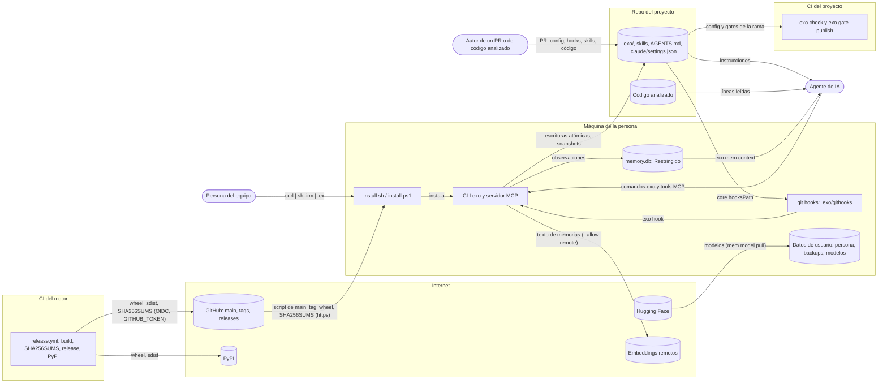

# Threat model del motor `exo`

- **Criterio:** 8 de la v1.0 (`docs/plan/fases/F8-endurecimiento-y-distribucion.md`).
- **Código modelado:** la rama `feat/F8-v1` en `cee801a`, con las mitigaciones que el dueño eligió para la v1.0 y los arreglos de la revisión final. Versión `1.0.0` (`src/exo/_meta.py:16`).
- **Citas:** cada `path:line` y cada commit se verificó contra `cee801a`. Una fila que dice "hasta `<commit>`" describe un riesgo que ya se mitigó, y nombra el commit que lo mitigó.
- **Método:** STRIDE con la escala de la skill `threat-modeling` (`content/packs/security/skills/threat-modeling/references/stride.md`). Las categorías OWASP salen de `content/packs/core/shared/owasp-2025.md`, siempre con año y CWE.
- **Quién acepta el riesgo residual:** el dueño del motor, en el rol `tech_lead` de este repo. Un residual Medio o más alto sin ADR que lo acepte queda **pendiente** de su aceptación o de la mitigación propuesta.

## Cómo se lee

- **P × I:** probabilidad e impacto **sin** la mitigación; el riesgo sale de la matriz de `stride.md`.
- **Residual:** la misma matriz con la mitigación puesta. Una mitigación baja la probabilidad; solo un cambio de diseño baja el impacto. Un impacto Alto o Crítico baja a Bajo solo si un test fija la mitigación; sin test queda en Medio como mínimo.
- **Impacto Crítico** es ejecutar código como la persona en su máquina o en la CI, o exponer una credencial: es tomar el sistema (`stride.md`, Impact).
- Los IDs son `TM-n`. Las mitigaciones propuestas son `M-n` y están al final, ordenadas por riesgo.

## Alcance

**Entra:** el motor y todo lo que lo rodea hasta que llega a una máquina o a un proyecto:
1. los instaladores remotos y su remoto simulado de los tests;
2. el release y la CI del motor;
3. los git hooks y el gobierno que corre en las máquinas del equipo y en la CI de cada proyecto;
4. el servidor MCP y el CLI como interfaz del agente (ADR-0005);
5. la memoria por usuario y sus proveedores de embeddings;
6. la ingeniería inversa;
7. las skills, los subagentes y los contratos de los packs;
8. `exo update` y `exo sync`;
9. las personas;
10. los runners de evals y de escenarios;
11. las variables de entorno `EXO_*`.

**Queda afuera:**
- los agentes (Claude Code, Copilot y los demás), sus sandboxes y sus sistemas de permisos, salvo cómo el motor los configura;
- la infraestructura de GitHub, PyPI y Hugging Face;
- el código propio de cada proyecto y la calidad del contenido de las skills, salvo como canal de instrucciones para el agente.

## Activos

| Activo | Nivel | Por qué importa |
|---|---|---|
| A1. Las máquinas del equipo: ejecutar código como la persona | Crítico | Todo lo demás de la persona cuelga de ahí: claves SSH, tokens, sesiones |
| A2. Credenciales: tokens del host del repo, `GITHUB_TOKEN` y OIDC de la CI, la API key de embeddings | Crítico | Con ellas se publica, se comenta en PRs o se lee código privado |
| A3. Integridad de lo que se distribuye: el script del instalador, el wheel, el sdist, el release de GitHub y PyPI | Crítico | Un artefacto alterado llega a cada máquina que instala |
| A4. Los archivos del proyecto: los del humano y los que genera el motor | Interno o Restringido | El motor escribe en repos ajenos |
| A5. La memoria por usuario (`memory.db`) y sus exports | Restringido | Junta observaciones de todos los proyectos de la persona y, por el riesgo aceptado de ADR-0009, puede tener secretos |
| A6. Los controles de gobierno: hooks, `exo check`, gates, `waivers.json`, `governance.*` | Integridad | Son lo que frena un secreto o un cambio sin aprobar |
| A7. Las instrucciones que lee el agente: `AGENTS.md`, skills, subagentes, contratos, overlays, memoria, `.claude/settings.json` | Integridad | Cambiarlas cambia lo que hace el agente en la máquina de cada persona |
| A8. La disponibilidad del flujo: subagentes, la CI, el servidor MCP | Disponibilidad | Sin ellos el ciclo SDD degrada |
| A9. Los datos de usuario fuera del repo: `persona.json`, `uninstall-backups/`, modelos | Interno | Viven fuera del control de versiones |

## Puntos de entrada

| Punto de entrada | Quién lo alcanza |
|---|---|
| `curl … \| sh` e `irm … \| iex` sobre los scripts de `main` | Cualquiera que instala; los cambia quien escribe en `main` |
| `EXO_REF`, `EXO_REPO_URL` y las demás `EXO_*` | Quien controla el entorno de la persona |
| Tags `v*`, `workflow_dispatch` y PRs del repo del motor | Quien tiene escritura; los PRs, cualquiera |
| Archivos versionados del proyecto: `.exo/`, hooks, skills instaladas, `AGENTS.md`, `.claude/settings.json` | Cualquiera que abre un PR o empuja una rama |
| Comandos `exo …` que corre el agente | El agente, influido por todo lo que lee |
| Tools del servidor MCP por stdio | El agente que lo lanzó |
| Código del proyecto analizado en la ingeniería inversa | Quien escribió ese código |
| Respuestas del proveedor de embeddings y de Hugging Face | Esos servicios |
| `evals.json`, los escenarios y los fixtures de los runners | Quien escribe en este repo |

## Fronteras de confianza

- **Internet → máquina:** el instalador, `exo mem model pull`, los embeddings remotos.
- **Repo y CI del motor → artefactos publicados:** lo que se construye es lo que se instala.
- **Contenido versionado del proyecto → procesos locales:** lo escribe cualquiera con un PR y lo ejecutan git (hooks), el motor (config) y el agente (instrucciones).
- **Agente → motor:** el agente es un llamador a medias confiable: puede seguir instrucciones escondidas en lo que lee.
- **Motor → disco fuera del proyecto:** la carpeta de datos de usuario, y cualquier ruta a la que apunte un link.
- **Código analizado → modelo:** leer una línea la manda al proveedor del modelo.
- **Rama de un PR → CI del proyecto:** la CI corre con la config de la rama y con los tokens del pipeline.

## Diagrama de flujo de datos



## Amenazas por superficie

### 1. Instaladores remotos

`install.sh`, `install.ps1`, `uninstall.*` y `tests/_remote.py`.

| ID | STRIDE | Activo | Escenario | P × I | Mitigación existente o riesgo aceptado | Residual |
|---|---|---|---|---|---|---|
| TM-1 | Tampering → Elevation of privilege | A1, A3 | El comando documentado baja el script de la rama `main` (`install.sh:5`, `install.ps1:32`), no de un tag. Quien empuja a `main` (o roba la cuenta del dueño) cambia el script, y cada `curl … \| sh` siguiente corre su código, aunque después instale un release. | Baja × Crítico = Alto | TLS de raw.githubusercontent.com (`curl -fsSL`); todo corre desde `main "$@"` en la última línea, así un corte no ejecuta medio script (`install.sh:315-317`, `install.sh:432`). Por pipe, PowerShell corre todo dentro de un bloque y termina con `throw`, nunca con `exit`, así que no le deja a la sesión de quien lo invoca sus funciones ni sus variables, ni `$ErrorActionPreference` cambiada (`install.ps1:50-55`). Aun así, la sesión no queda igual: `SecurityProtocol` suma TLS 1.2 en todo el proceso (`install.ps1:316-317`), la carpeta del motor se agrega al `$env:Path` de la sesión (`:393-395`), y el `param()` (`:43-48`) define `$Init`, `$WithVector` y `$NoPath` mientras corre (en Windows PowerShell 5.1 no quedan en la sesión después de `irm \| iex`, probado el 2026-11-25; en PowerShell 7 no se probó). Desde `65659bc` deja `GIT_ALLOW_PROTOCOL` como estaba (`:306`, `:377`; test `tests/test_installers.py:770`). Los encabezados muestran cómo bajarlo y leerlo antes (`install.sh:7-11`, `install.ps1:26-29`). Desde `979c3f9`, el checklist del release pide que `main` exija PR sin bypass (`docs/checklists/F8-v1.md:100-106`): es configuración de GitHub que no se ve desde el código (supuesto S-2). Nada fija el contenido del script. | **Alto**, pendiente: M-4 |
| TM-2 | Tampering | A1 | Alguien que controla el entorno pone `EXO_REPO_URL` o `EXO_REF` para instalar desde un espejo propio o un ref con caracteres que cambian la URL o el requisito de pip. | Baja × Bajo = Bajo | Solo `https://`, `file:///` y http a `127.0.0.1`/`localhost`; sin `@`, `?` ni `#`, y sin barras finales (`install.sh:97-128`, `install.ps1:58`, `:171-182`). Desde `a7d38c8`, el puerto de loopback de `install.sh` tiene que ser solo dígitos: el glob anterior aceptaba `127.0.0.1:1.example.com` (`install.sh:116-125`). Refs sin `..`, sin `-` inicial y con caracteres acotados (`install.sh:130-137`, `install.ps1:184-191`); un espejo `file://` sin `EXO_REF` pide el ref (`install.sh:226-228`, `install.ps1:318-321`). Tests `tests/test_installers.py:554`, `:565`, `:577`, `:587`, `:692`, `:888`, `:898`. La excepción de `file://` y loopback no sale de la máquina y sirve para los tests y para un espejo local. El impacto es Bajo porque quien controla el entorno ya corre código como la persona (ADR-0006, `docs/adr/0006-agentes-y-deteccion.md:44`). | Bajo |
| TM-3 | Tampering | A1, A3 | Una redirección de la descarga, o del clon que hace git, baja a `http://` y alguien en la red cambia el wheel **y** su `SHA256SUMS`, o el código que se clona. | Baja × Crítico = Alto | Desde `67d4b8a`, ninguna descarga sigue un salto a otro protocolo. Con curl, `--proto` y `--proto-redir` con el protocolo de `EXO_REPO_URL` (`install.sh:139-146`). Con `https` y sin curl no se baja nada: wget sigue redirecciones a cualquier protocolo, así que `fetch` pide curl (`install.sh:147-149`) y wget queda para http a loopback; `redirect_of` con wget no sigue el salto (`--max-redirect=0`, `install.sh:160`). En PowerShell, `Save-Url` sigue las redirecciones a mano y rechaza la que cambia de protocolo antes de pedirla, en cada salto y no solo en la URI final (`install.ps1:193-225`, `:219-221`). Desde `65659bc`, el git que corren uv y pip (siempre con uv; sin uv, para una rama o un commit) recibe `GIT_ALLOW_PROTOCOL` con el protocolo de `EXO_REPO_URL` más `file`, porque uv clona desde su caché local, y una redirección por http no lleva a `file` (`install.sh:262-270`, `install.ps1:346-351`); antes, git seguía el salto. El remoto simulado responde `302` de `http://127.0.0.1` a `https://` en un puerto que rechaza conexiones, para el wheel y para un repo de git entero (`tests/_remote.py:139-145`, `:260-263`); tests `tests/test_installers.py:467` (curl), `:528` (sin curl no se usa wget), `:732` (PowerShell), y `:483` y `:753` (git, con uv y con pip). Hoy GitHub redirige solo a https (supuesto S-4). Sin uv y sin curl no se puede instalar un release desde https (M-6 descartada). | Bajo |
| TM-4 | Tampering, Spoofing | A3 | `SHA256SUMS` sale del mismo release que el wheel: quien puede editar el release (la cuenta del dueño, el `GITHUB_TOKEN` con `contents: write` o una action comprometida en ese job) cambia los dos juntos. El checksum prueba integridad, no autenticidad. | Baja × Crítico = Alto | El checksum frena una descarga cortada o un asset cambiado solo (`install.sh:192-212`, `install.ps1:259-300`); exige exactamente un wheel con nombre acotado (`install.sh:195-200`, `install.ps1:276-279`); tests `tests/test_installers.py:442`, `:703`. No hay firma ni atestación del build. | **Alto**, pendiente: M-4 |
| TM-5 | Tampering | A3 | El camino con uv (y sin uv, una rama o un commit) instala con git sobre https en el ref (`install.sh:253-270`, `install.ps1:333-352`), sin checksum. Un tag se puede mover con un force-push, y el mismo ref pasa a apuntar a otro código. | Baja × Crítico = Alto | TLS y la identidad de GitHub. Desde `65659bc`, git usa solo el protocolo de `EXO_REPO_URL` (y `file`, para la caché de uv), así que una redirección no lo baja a http (TM-3). `uv tool install` sin `--force` no pisa otro `exo` (`install.sh:359-360`, `install.ps1:357-358`). Desde `7d9a9f6`, volver a instalar una rama sin uv trae su último commit (`--force-reinstall`: `install.sh:381-388`, `install.ps1:366-370`; tests `tests/test_installers.py:425`, `:677`), con lo bueno y lo malo de seguir una rama. Nada impide mover un tag: el checklist del release pide un ruleset de tags (`docs/checklists/F8-v1.md:107`), que no se ve desde el código (supuesto S-2). | **Alto**, pendiente: M-4 |
| TM-6 | Tampering | A3 | Hasta `c46eac6`, sin uv, si bajar `SHA256SUMS` fallaba por cualquier razón (red, una redirección rechazada, un release sin el archivo), el instalador pasaba en silencio a git sobre el mismo ref, sin checksum: un *fail open*. | Media × Bajo = Bajo | Desde `0c60bc5`, un ref con forma de release (`v` y un dígito, como los tags de `release.yml`) se detiene si su `SHA256SUMS` no baja, con un mensaje accionable y la causa de la descarga (`install.sh:234-252`, `install.ps1:259-275`); test con un tag de git cuyo release no trae `SHA256SUMS` (`tests/_remote.py:240-242`): `tests/test_installers.py:452`, `:715`. Una rama o un commit siguen yendo por git, sin checksum, porque no tienen release; ese camino es https al mismo origen y, desde `65659bc`, sin saltos a otro protocolo (TM-3). | Bajo |
| TM-7 | Spoofing | A1 | Hay otra herramienta que se llama `exo` (ADR-0001) y el instalador la pisa, o la persona corre la otra creyendo que es el motor. | Media × Medio = Medio | El link de `~/.local/bin/exo` se pisa solo si apunta al venv del motor (`install.sh:363-373`); uv sin `--force` no reemplaza una herramienta ajena (`install.sh:359-360`, `install.ps1:357-358`); desde `2537a10`, `uninstall.ps1` desinstala con uv solo `exo-harness`, no `exo-harness-x` (`uninstall.ps1:100-104`; test `tests/test_installers.py:829`). Desde `e3e09c2`, si otro `exo` va antes en el PATH (con `install.ps1`, que agrega su carpeta al final del PATH de usuario, o con `--no-path`), los dos instaladores avisan con su ruta, sin frenar (`install.sh:297-306`, `:417-419`, `:424`; `install.ps1:159-169`, `:398-401`), y `exo doctor` lo informa (`src/exo/doctor.py:67-83`); tests `tests/test_installers.py:249`, `:265`, `:284`, `:299`. El README y la ayuda lo dicen (`README.md:33`, `install.sh:36-37`, `install.ps1:15-17`). El paquete se llama `exo-harness` (`pyproject.toml:9`). Queda un `exo` que otro archivo de inicio antepone después de la línea del instalador: no se avisa, pero `exo doctor` lo ve. | Bajo |
| TM-8 | Tampering | A9 | Hasta `c46eac6`, `uninstall.ps1` pasaba `$Venv`, armado con `EXO_DATA_DIR`, a `Test-Path` y `Remove-Item` sin `-LiteralPath`: con `[`, `]` o `*` en la ruta, PowerShell la leía como comodín, y con `datos[1]` borraba `datos1\venv` y dejaba el propio; `install.ps1` no encontraba el `exo.exe` recién instalado. | Baja × Medio = Bajo | Desde `b24d6de`, `-LiteralPath` en `uninstall.ps1:107-113` y en `install.ps1:380-382`; el resto ya lo usaba, y `Join-Path` y `New-Item -Path` no expanden comodines en 5.1 (probado con `datos[1]`). Tests con `datos[1]` y una `datos1\venv` al lado: `tests/test_installers.py:794` (desinstalar) y `:854` (instalar por pipe y desinstalar). Desde `2537a10`, un `path-entry.txt` vacío no corta `uninstall.ps1` ni llega a `Test-Path` (`uninstall.ps1:115-128`; test `tests/test_installers.py:840`). `uninstall.sh` borra solo `$DATA_DIR/venv` y el link si apunta ahí (`uninstall.sh:51-60`). | Bajo |
| TM-9 | Information disclosure | A4 | Mientras corren los tests de instaladores, el remoto simulado sirve por http una foto del árbol que incluye los archivos sin trackear que git no ignora (`tests/_remote.py:182-196`): otro usuario de la máquina puede leerlos en esa ventana. | Baja × Medio = Bajo | Escucha solo en `127.0.0.1`, en un puerto libre, mientras dura el bloque (`tests/_remote.py:253-272`); git aislado de la config del dev (`tests/_remote.py:163-176`), también en `Remote.commit` (`tests/_remote.py:95-120`). | Bajo |

### 2. Release y CI del motor

`.github/workflows/release.yml` y `.github/workflows/ci.yml`.

| ID | STRIDE | Activo | Escenario | P × I | Mitigación existente o riesgo aceptado | Residual |
|---|---|---|---|---|---|---|
| TM-10 | Tampering → Elevation of privilege | A2, A3 | Una action de terceros se compromete y se mueve su tag (o su rama, como la `release/v1` de PyPI en `93fe606`): corre en el job con `contents: write` o con `id-token: write` y publica un release o un paquete alterado. | Baja × Crítico = Alto | Desde `b368bc8`, todas las actions van fijadas por SHA con su versión en un comentario (`release.yml:44`, `:48`, `:69`, `:73`, `:109`, `:115`, `:132`, `:136`, `:141`, `:179`, `:184`, `:198`, `:203`; `ci.yml:28`, `:32`, `:74`, `:78`, `:99`, `:103`, `:124`, `:128`, `:148`), y Dependabot propone cada versión nueva como PR (`.github/dependabot.yml:5-12`); tests `tests/test_workflows.py:75` y `:194`. Desde `78fd273`, ningún `actions/checkout` deja el token en `.git/config` para los pasos siguientes (`persist-credentials: false`: `release.yml:46`, `:71`, `:134`; `ci.yml:30`, `:76`, `:101`, `:126`; test `tests/test_workflows.py:157`), y el release lo crea `gh` con `GH_TOKEN` (`release.yml:146-149`, `:165`). Mínimo privilegio: `contents: read` por defecto (`release.yml:33-34`, `ci.yml:10-11`); escritura solo en el job del release (`release.yml:127-128`); OIDC solo en los jobs de PyPI (`release.yml:176-177`, `:195-196`); el environment `pypi` con aprobación del dueño (`release.yml:12-15`, `:173-175`, supuesto S-3). Queda que una versión comprometida entre por un PR de Dependabot aprobado sin revisar. | Bajo |
| TM-11 | Tampering | A3 | El build instala `build` y `twine` sin versión (`release.yml:90`) y el backend `hatchling>=1.27` (`pyproject.toml:1-4`) desde PyPI, sin hashes: una versión comprometida de cualquiera de los dos mete código en el wheel que después se firma con el checksum. En la CI y en el job `tests` del release, `pip install -e ".[dev]"` (`ci.yml:42`, `release.yml:58`, `pyproject.toml:43`) tiene el mismo problema con menos impacto (token de solo lectura). | Baja × Crítico = Alto | El wheel se instala en un venv limpio y corre `exo --version` y `exo validate` (`release.yml:96-101`), que detecta un paquete roto, no uno alterado. | **Alto**, pendiente: M-5 |
| TM-12 | Elevation of privilege | A3 | Quien tiene escritura empuja un tag `v*` y sale un release de GitHub sin aprobación: el environment con revisores protege solo el job de PyPI (`release.yml:121-128` frente a `:167-177`). Sin uv, `install.sh` instala el último release de GitHub. | Baja × Crítico = Alto | El tag tiene que coincidir con `_meta.VERSION` (`release.yml:77-86`); `gh release create --verify-tag` (`release.yml:160-165`). Hoy solo el dueño escribe (supuesto S-1). | **Alto**, pendiente: M-4 |
| TM-13 | Tampering | A2 | Inyección de comandos en un `run:` a través del nombre del tag o de otra expresión `${{ }}`. | Baja × Crítico = Alto | Las expresiones entran por `env:` y no dentro del script (`release.yml:79-80`, `release.yml:147-149`); desde `b368bc8`, un test falla si un `run:` de cualquier workflow contiene `${{` (`tests/test_workflows.py:60`). | Bajo |
| TM-14 | Elevation of privilege | A2 | Un PR desde un fork corre código en la CI. | Media × Bajo = Bajo | `pull_request`, no `pull_request_target` (`ci.yml:4-8`; test `tests/test_workflows.py:67`), con `contents: read` (`ci.yml:10-11`) y sin secretos; el release no reutiliza artefactos de la CI: `download-artifact` baja solo los de su corrida (`release.yml:136-144`). | Bajo |
| TM-15 | Tampering | A3 | `workflow_dispatch` publica en TestPyPI el build de cualquier rama, con el environment `testpypi` sin reglas (`release.yml:15`, `release.yml:186-205`). | Baja × Bajo = Bajo | Solo quien tiene escritura lanza el workflow; TestPyPI no es lo que se instala; sin tokens guardados (ADR-0017, `docs/adr/0017-repo-publico-ci-y-distribucion.md:41`). | Bajo |

### 3. Git hooks y gobierno en las máquinas y en la CI del proyecto

`src/exo/governance/`, `core.hooksPath` y `exo gate publish`.

| ID | STRIDE | Activo | Escenario | P × I | Mitigación existente o riesgo aceptado | Residual |
|---|---|---|---|---|---|---|
| TM-16 | Elevation of privilege | A1 | `core.hooksPath` apunta a `.exo/githooks/`, una carpeta **versionada** (`src/exo/governance/githooks.py:34`, `:114-119`, `:160`; `src/exo/adapters/generic.py:81-84`). Git no corre hooks versionados justamente por esto: un PR, o una rama de un compañero, cambia `.exo/githooks/pre-commit`, y quien hace checkout de esa rama y commitea ejecuta ese código. | Baja × Crítico = Alto | Los hooks están en el lock: `exo doctor` avisa un cambio a mano (`src/exo/doctor.py:162-168`) y `exo sync` informa el conflicto (`src/exo/installer/engine.py:417-426`) o reescribe el hook si el PR también tocó el lock (`engine.py:427-432`); `exo codeowners` le da al `tech_lead` `.exo/` y, desde `378d004`, también `.husky/`, `.pre-commit-config.yaml` y `.gitattributes` (`src/exo/commands/governance.py:63-72`, `:91-101`; test `tests/test_p0.py:64`), así que un hook alterado no llega a `main` sin su revisión si el host la exige (supuesto S-5). Nada de eso actúa antes del checkout de una rama que todavía no se revisó, y `exo check` no compara los hooks con los del motor (`src/exo/sdd/check.py:408-462`). | **Alto**, pendiente: el resto de M-3 |
| TM-17 | Repudiation, Tampering | A6 | Alguien saltea los hooks con `--no-verify`, o no tiene `exo` en el PATH y el hook sale con 0 (`githooks.py:57-61`). | Alta × Medio = Alto | **Riesgo aceptado** por el dueño en ADR-0014: los hooks son ayuda temprana y la CI es el gate (`docs/adr/0014-enforcement-agnostico.md:28-29`). `exo check --base` repite el escaneo en la CI (`content/packs/core/shared/ci-and-review.md:10`, `:15-24`) y falla cerrado si git falla (`src/exo/sdd/check.py:388-391`; `src/exo/governance/hookrun.py:164-172`, `:303-309`). | Bajo, si la protección de rama exige la CI (supuesto S-5) |
| TM-18 | Tampering | A1 | `EXO_HOOK_CMD` reemplaza el ejecutable que corre el hook, sin comillas (`githooks.py:36`, `:54-56`). | Baja × Bajo = Bajo | La define quien controla el entorno de la persona, que ya corre código como ella (ADR-0006, `docs/adr/0006-agentes-y-deteccion.md:44`). | Bajo |
| TM-19 | Tampering | A6 | `exo check` lee la config y los waivers de la **rama del PR** (`src/exo/sdd/check.py:417`; `hookrun.py:132-137`): un PR vacía `governance.gates` de su tier, saca detectores de `data_protection.pii` o suma un waiver con un `approved_by` que escribe él mismo, y su propio gate pasa. | Media × Alto = Alto | Un secreto nunca tiene waiver (`src/exo/core/waivers.py:88-91`); el motor no verifica roles y la aprobación efectiva es CODEOWNERS más la protección de rama (`ci-and-review.md:167-175`), con `.exo/` para el `tech_lead` (`src/exo/commands/governance.py:91-101`). Depende de que el proyecto lo configure. | **Medio**, pendiente: M-2 |
| TM-20 | Elevation of privilege | A2 | `exo gate publish` corre `review.publish_command` de la config de la rama con `shell=True` (`src/exo/governance/gates.py:136`, `:150-178`), y el comando que recomienda el contrato ejecuta un script del repo (`sh scripts/publish-gate.sh`). En una CI que publica con un token de escritura, el autor del PR elige el comando, el script que corre o el pipeline mismo, y se lleva el token. | Media × Crítico = Crítico | Por defecto es `null` y solo imprime (`src/exo/core/config.py:104`; `gates.py:137-142`). El comando corre solo si esta máquina lo aprobó, y desde `6352cc4` la aprobación queda atada a la raíz resuelta del proyecto, al texto exacto y al SHA256 de cada archivo del proyecto que nombra el comando; desde `81688af`, en Windows, también a los `<palabra>.cmd` y demás nombres de `PATHEXT` que `cmd` busca primero en la raíz (`src/exo/governance/approvals.py:111-137`, `:195-230`; `gates.py:139-149`). Otro repo, otro texto o un script cambiado o plantado vuelven a preguntar, y el mensaje nombra el archivo (tests `tests/test_gates_publish.py:272`, `:300`, `:321`, `:355`). Eso cubre a quien publica desde su máquina una rama ajena: ve el comando y los archivos que corre, y un cambio al script le vuelve a preguntar. `exo codeowners` le da al `tech_lead` los archivos que nombra el comando (`src/exo/commands/governance.py:87-100`; test `tests/test_gates_publish.py:474`). En la CI no alcanza: la carpeta de datos es nueva en cada corrida, así que `--approve-command` (`src/exo/commands/gate.py:34-42`) fija solo el texto y aprueba el script como lo trae la rama; y en un `pull_request` de GitHub Actions, un build validation de Azure Pipelines o un pipeline de merge request de GitLab, la definición del pipeline también sale de la rama. Ahí la protección es el contrato: publicar solo desde un pipeline cuya definición y script vengan de una ref confiable (después del merge, o con el script leído de la rama base), preferir un comando que no ejecute archivos de la rama, y nunca publicar con token de escritura en PRs de forks o en `pull_request_target` con los scripts del PR (`content/packs/core/shared/ci-and-review.md:103-105`). La aprobación no cubre lo que esos archivos leen o ejecutan a su vez. | **Alto**, pendiente: M-2 |

### 4. El servidor MCP y el CLI como interfaz del agente

`src/exo/mcp/`, `src/exo/tools/` y el permiso que el adaptador de Claude Code le da al agente.

| ID | STRIDE | Activo | Escenario | P × I | Mitigación existente o riesgo aceptado | Residual |
|---|---|---|---|---|---|---|
| TM-21 | Elevation of privilege | A1, A2 | Hasta `93fe606`, el adaptador agregaba `Bash(exo:*)` y `PowerShell(exo:*)` a `permissions.allow`, y el agente corría **cualquier** subcomando sin preguntar. Un agente con prompt injection (código revisado, un ticket, una página) corría `exo init --yes --publish-command "<cmd>"`, que reescribe la config sin preguntar (`src/exo/commands/project.py:67-71`, `:305`, `:356-375`, `:636-639`; `src/exo/installer/project.py:156-158`, `:182-184`), y después `exo gate publish`, que ejecuta `<cmd>` en un shell (`gates.py:164-166`). Era ejecución arbitraria sin ningún pedido de permiso. Con el mismo permiso podía habilitar embeddings remotos (`exo mem reindex --allow-remote`), borrar memoria o desinstalar con `--force`. | Media × Crítico = Crítico | Desde `02472cb`, el permiso cubre solo los subcomandos que las skills corren solas (`src/exo/adapters/claude_code.py:37-60`, `:63-67`, `:78-82`). `init`, `sync`, `update`, `uninstall`, `restore`, `gate`, `mem reindex`, `mem delete`, `mem export`, `mem import` y `mem projects` quedan afuera y los aprueba la persona (test `tests/test_adapters.py:109`), y `exo sync` reemplaza el permiso viejo en los proyectos instalados (test `tests/test_adapters.py:126`). Desde `c46eac6`, además, `exo gate publish` no corre un comando que esta máquina no aprobó, y desde `6352cc4` la aprobación vale para ese proyecto, ese texto y el contenido actual de los archivos que nombra el comando. Con TTY muestra el comando y esos archivos y pregunta; sin TTY se niega y los nombra; y `--approve-command` aprueba solo si coincide con el texto que `gates.publish` lee para correrlo (`src/exo/governance/gates.py:110-149`; `src/exo/commands/gate.py:48-55`, `:66-80`; `src/exo/governance/approvals.py:195-230`; tests `tests/test_gates_publish.py:177`, `:216`, `:272`, `:449`). En una sesión interactiva, Claude Code aplica las reglas al aceptar la confianza del workspace; en `-p` no se verificó (`claude_code.py:5-10`). Copilot no recibe la regla (ADR-0005), así que pregunta; para las corridas desatendidas de Copilot (`copilot -p`), la guía recomienda una regla `--allow-tool` por subcomando y deja `shell(exo:*)` solo para un sandbox descartable (`docs/guides/copilot.md:53`, `:64`, sección "Non-interactive runs"). Queda un camino social: la persona aprueba en el agente un `exo gate publish --approve-command` cuyo pedido de permiso muestra el comando, pero no el contenido de los archivos que corre. | Bajo; el camino social, en la propuesta de M-1 |
| TM-22 | Tampering, Information disclosure | A4 | Un agente pasa a una tool un `cwd` o un `target` fuera del proyecto, nombres con `..` o argumentos de más, para leer o comparar otra carpeta. | Media × Alto = Alto | Validación S2 compartida por el CLI y el MCP (ADR-0005, `docs/adr/0005-cli-primero-mcp-opcional.md:17-18`): `cwd` resuelto dentro de la raíz (`src/exo/tools/validation.py:43-56`), nombres de skill y de change acotados (`validation.py:24-40`), argumentos desconocidos rechazados (`validation.py:66-69`; `src/exo/tools/base.py:40-48`), `target` con `resolve_within` (`src/exo/tools/registry.py:98-102`); tests `tests/test_tools.py:43`, `:59`, `:64`, y la regresión de `exo p0` (`src/exo/governance/p0.py:82-112`). El MCP está apagado por defecto (`src/exo/core/config.py:106`; `claude_code.py:87-90`). | Bajo |
| TM-23 | Information disclosure | A5 | `mem_get` y `mem_delete` aceptan cualquier ID, de cualquier proyecto (`src/exo/tools/memory.py:154-155`, `:163-167`; `src/exo/memory/store.py:508-522`), y `all_projects` abre la búsqueda a todos (`tools/memory.py:37`, `:85-86`). Un agente con prompt injection en el proyecto A lee observaciones del proyecto B (otro cliente) y las deja en un commit, un PR o una página. | Media × Medio = Medio | Las búsquedas y listas van al proyecto detectado salvo que se pida lo contrario (`tools/memory.py:85-86`). La memoria es por usuario y sin auth por decisión (ADR-0009, `docs/adr/0009-memoria-por-usuario.md:26-29`), pero esa decisión no trata la lectura cruzada por un agente. | **Medio**, pendiente: M-8 |
| TM-24 | Tampering | A5 | Las tools que escriben (`mem_delete`, `mem_projects_merge`, `mem_projects_consolidate`: `tools/memory.py:305-311`, `:358-378`) borran o mezclan sin confirmación y sin vuelta atrás (`store.py:508-513`). | Baja × Medio = Bajo | `consolidate` tiene `dry_run`; los IDs se validan (`tools/memory.py:42-51`). | Bajo |
| TM-25 | Denial of service, Tampering | A8 | Una librería nativa escribe en el descriptor 1 durante una tool y rompe el protocolo, o una línea gigante sin fin agota la memoria del servidor. | Baja × Bajo = Bajo | stdout de Python redirigido a stderr durante cada tool (`src/exo/mcp/server.py:72-75`); salida en ASCII, siempre JSON válido (`server.py:113-116`); una tool o un mensaje que falla no tiran el servidor (`server.py:79-81`, `:119-129`; test `tests/test_mcp.py:152`). `contextlib.redirect_stdout` no cubre el descriptor 1 de una librería en C, y `for raw in stdin` no limita el largo de la línea (`server.py:142`). El cliente es local. | Bajo (M-18) |

### 5. La memoria

Una base SQLite por usuario, sin guard, con export sin redactar y con proveedores de embeddings.

| ID | STRIDE | Activo | Escenario | P × I | Mitigación existente o riesgo aceptado | Residual |
|---|---|---|---|---|---|---|
| TM-26 | Information disclosure | A2, A5 | Un agente guarda un token en una observación y la persona después la comparte con `exo mem export`, que sale sin redactar (`src/exo/memory/exchange.py:34-59`). | Baja × Crítico = Alto | **Riesgo aceptado** por el dueño en ADR-0009 (`docs/adr/0009-memoria-por-usuario.md:30-32`, `:62`) y D-24 (`docs/plan/04-DECISIONES.md:159`). Pauta para el agente en las reglas (`content/rules/AGENTS.base.md:10`, `:51`); la ayuda del comando dice "unredacted" (`src/exo/commands/memory.py:510`). | Alto, **aceptado** (ADR-0009) |
| TM-27 | Information disclosure | A5, A9 | Hasta `93fe606`, en Linux la carpeta de datos se creaba con el `umask` y los archivos nuevos quedaban en `0644` (`src/exo/core/fsutil.py:24`): en una máquina compartida, otro usuario leía `memory.db`, `persona.json`, los `uninstall-backups/` con el contenido de `.exo/` de cada proyecto y lo que escribía `exo mem export --output`. | Baja × Alto = Medio | Desde `2634c05`, en POSIX: `paths.private_dir` crea en `0700` las carpetas que faltan, sin tocar las que ya existen (`src/exo/paths.py:19-49`); la base y sus `-wal` y `-shm` quedan en `0600`, también una base vieja al abrirla (`src/exo/memory/db.py:70-97`); `persona.json`, `approved-commands.json`, los backups de desinstalación y `exo mem export --output` se escriben en `0600` (`src/exo/persona.py:97-98`; `src/exo/governance/approvals.py:229-230`; `src/exo/installer/project.py:336-337`; `src/exo/commands/memory.py:177`); `exo doctor` avisa si otros leen la carpeta de datos (`src/exo/doctor.py:374-400`). Tests `tests/test_private_data.py:45`, `:59`, `:68`, `:85`, `:93`. Desde `9b9a35d`, `install.sh` crea la carpeta de datos y las que le falten en `0700`, sin tocar una que ya existe, antes del venv y del PATH (`install.sh:290-295`, `:376`, `:401`); test `tests/test_installers.py:366`. Desde `8ae0bf1`, los chmod son best-effort: en vfat o exFAT, que rechazan chmod, la memoria abre, `uninstall` saca su backup y `persona set` y la aprobación escriben igual (`src/exo/paths.py:47-48`; `src/exo/memory/db.py:86-89`; `src/exo/core/fsutil.py:138-141`; tests `tests/test_private_data.py:166`, `:181`), y `exo doctor` sigue avisando con `data-dir`. `exo mem model pull` crea la carpeta de datos privada (`src/exo/memory/embeddings/__init__.py:145`; test `tests/test_private_data.py:144`), y hay un test POSIX de `uninstall-backups/` (`:125`). Desde `14f321a`, en Windows `data-dir` dice `ok` solo bajo `%LOCALAPPDATA%`, e `info` fuera (`src/exo/doctor.py:364-372`, `:380-391`; test `tests/test_private_data.py:110`). En Windows `%LOCALAPPDATA%` es por usuario y en macOS `~/Library` es `0700` (supuesto S-10). | Bajo |
| TM-28 | Information disclosure | A5 | Las memorias de **todos** los proyectos salen a un servicio remoto de embeddings. | Baja × Alto = Medio | Un proveedor remoto exige `--allow-remote` (`src/exo/memory/embeddings/__init__.py:109-115`); el permiso vive en la `meta` de la base, no en el repo (`src/exo/memory/index.py:45-56`; `store.py:211-218`; ADR-0009, `:63`), así que un PR no lo prende, y `exo doctor` avisa que la sección `memory` del proyecto no tiene efecto (`src/exo/doctor.py:342-351`); Ollama fuera de loopback también lo exige y el local va sin proxies (`src/exo/memory/embeddings/http.py:35-39`, `:107-116`), y desde `8bafec1`, `openai-compatible` a una URL de esta máquina tampoco pasa por un proxy (`http.py:135`, `:148-153`; test `tests/test_memory_providers.py:103`); tests `tests/test_memory_semantic.py:208`, `tests/test_memory_providers.py:79`. El riesgo lo acepta la persona que pasa `--allow-remote` (invariante 11, `AGENTS.md:25`); desde `02472cb`, `exo mem reindex` queda fuera del permiso del agente (TM-21). | Bajo |
| TM-29 | Information disclosure | A2 | Hasta `93fe606`, la API key del proveedor `openai-compatible` viajaba a otro destino: `urllib` sigue las redirecciones y **reenvía `Authorization`** al nuevo origen (verificado el 2026-11-24 con Python 3.14: un `302` a otro puerto recibió `Bearer …`), y `EXO_EMBEDDINGS_URL` aceptaba `http://` sin chequeo. | Baja × Crítico = Alto | Desde `28ae30e`, los dos openers usan `_NoRedirect`: un 3xx es un error que dice adónde redirigía, y ni la clave ni el texto van a otra dirección (`src/exo/memory/embeddings/http.py:26-39`, `:56-66`); `EXO_EMBEDDINGS_URL` tiene que ser `https://`, salvo http a esta máquina (`http.py:134-141`). Tests `tests/test_memory_providers.py:155` y `:174`. La clave sale de una variable de entorno, nunca de la base (`http.py:1-6`, `:143-146`). | Bajo |
| TM-30 | Tampering | A7 | Envenenamiento de la memoria: un agente con prompt injection guarda una "convención" con instrucciones, y `exo mem context` se la inyecta en las sesiones siguientes (`content/rules/AGENTS.base.md:48`); si es `personal`, en todos los proyectos (`store.py:5`). | Media × Medio = Medio | Tipos y `topic_key` validados (`src/exo/memory/model.py:21-22`); nada marca la memoria como dato ni dice de qué sesión o agente vino. | **Medio**, pendiente: M-8 |
| TM-31 | Tampering, Denial of service | A5 | Un export armado o entradas enormes rompen la base o la llenan. | Baja × Medio = Bajo | `import` valida todo antes de escribir, en una transacción, y no pisa lo local más nuevo (`exchange.py:5-7`, `:76-119`); límites de contenido, título y resultados (`model.py:16-19`; `store.py:56`, `:63`; `tools/memory.py:241-242`). | Bajo |
| TM-32 | Tampering | A1, A5 | `exo mem model pull` baja de Hugging Face sin fijar revisión ni hash (`src/exo/memory/embeddings/static.py:58-71`; `src/exo/memory/embeddings/onnx.py:61-69`): un repo comprometido entrega otro modelo. | Baja × Medio = Bajo | Solo con el comando explícito (ADR-0009, `:38`); al usarlo, solo archivos locales (`onnx.py:36-39`); `static` baja solo `json`, `safetensors`, `txt` y `model`, sin pickles (`static.py:66-70`). | Bajo (M-19) |

### 6. La ingeniería inversa

Invariante 10 (`AGENTS.md:24`): solo lectura sobre el código del proyecto analizado.

| ID | STRIDE | Activo | Escenario | P × I | Mitigación existente o riesgo aceptado | Residual |
|---|---|---|---|---|---|---|
| TM-33 | Tampering | A4 | El agente que extrae una unidad modifica el código analizado, por error o por una instrucción escondida. | Media × Alto = Alto | El motor escribe solo bajo `.exo/discovery/`, con `join_within` (`src/exo/discovery/store.py:46-55`); los subagentes `re-extractor` y `re-auditor` tienen solo `Read, Grep, Glob` (`content/packs/discovery/agents/re-extractor.md:4`, `content/packs/discovery/agents/re-auditor.md:4`; ADR-0015, `docs/adr/0015-ingenieria-inversa.md:109`); `exo discover status` lista los cambios fuera de las rutas permitidas (`src/exo/discovery/pipeline.py:54-63`, `:83-126`; ADR-0015, `:14`). Es detección, no prevención: inline (un agente sin subagentes) el agente tiene todas sus tools, y un cambio ya commiteado no aparece en `git status`. | **Medio**, pendiente: M-11 |
| TM-34 | Elevation of privilege | A1, A7 | Prompt injection desde el código: un comentario dirigido a la IA le pide al extractor correr un comando o cambiar lo que reporta. | Media × Alto = Alto | El motor marca esas líneas como `suspicious_lines` (`src/exo/discovery/units.py:110-124`, con `src/exo/validate.py:335-348`); la skill dice que son datos para reportar, nunca órdenes (`content/packs/discovery/skills/re-extract/SKILL.md:39`, `:45`); en modo subagente no hay shell (`re-extractor.md:4`). La detección es heurística. | **Medio**, pendiente: M-11 |
| TM-35 | Information disclosure | A2 | El extractor lee un secreto del código y lo manda al modelo, o lo copia al documento de la unidad. | Alta × Alto = Crítico | Los archivos de credenciales quedan como `sensitive` y no se leen (`src/exo/discovery/files.py:492-497`); `secret_lines` le dice a la skill que lea alrededor (`units.py:118-120`; `re-extract/SKILL.md:44`); `exo discover done` corre el escáner y un Crítico no tiene waiver (ADR-0015, `:69`). **Riesgo aceptado** en ADR-0015: leer esas líneas igual las manda al modelo. | Medio, **aceptado** (ADR-0015) |
| TM-36 | Denial of service, Elevation of privilege | A4, A8 | Un repo con archivos enormes o con links hace que el análisis lea fuera del proyecto o no termine. | Media × Medio = Medio | Nunca sigue symlinks ni junctions (`files.py:3-5`, `:383`, `:407`); salta lo que pasa de 1 MB (`files.py:41`, `:500-506`); timeout de `git log` (`src/exo/discovery/git_metrics.py:28`). | Bajo |
| TM-37 | Elevation of privilege | A1 | Correr git en un proyecto que llegó como archivo con su `.git/` (no como clon) ejecuta lo que diga su `.git/config` (por ejemplo `core.fsmonitor`) en `git status` o `git log` (`pipeline.py:94-101`; `git_metrics.py:63-80`). | Baja × Bajo = Bajo | Los diffs van sin diff externo ni textconv (`src/exo/governance/git.py:22-31`); `safe.directory` de git cubre las carpetas de otro dueño. El impacto incremental es Bajo: la persona corre git ahí de todos modos (supuesto S-9). | Bajo |

### 7. Las skills, los subagentes y los contratos de los packs

| ID | STRIDE | Activo | Escenario | P × I | Mitigación existente o riesgo aceptado | Residual |
|---|---|---|---|---|---|---|
| TM-38 | Tampering, Elevation of privilege | A7 | Una skill de terceros, o contenido propio con `EXO_CONTENT_ROOT` (`src/exo/content.py:29-35`), trae instrucciones escondidas: pisar las reglas, bajar y ejecutar, mandar datos afuera o caracteres invisibles. | Baja × Alto = Medio | `exo validate` advierte en `SKILL.md`, `references/`, scripts y subagentes (`validate.py:458-482`, `:564-567`, `:678`), y corre en la CI y en el release (`ci.yml:50-51`; `release.yml:101`); skills copiadas byte a byte, sin plantillas, así ningún valor de la config entra en una skill (invariante 7, `AGENTS.md:21`; `src/exo/installer/bundle.py:60-61`; `src/exo/adapters/base.py:66-71`); regla de no copiar skills de terceros sin licencia (`AGENTS.md:58`). Huecos: son advertencias; no cubren los contratos compartidos, los overlays ni las reglas base (`validate.py:571-586`, `:719-727`); y `exo sync` no valida el contenido de `EXO_CONTENT_ROOT`. | **Medio**, pendiente: M-12 |
| TM-39 | Tampering → Elevation of privilege | A1, A7 | Un PR edita lo que el motor instaló y leen los agentes de todo el equipo: una skill en `.claude/skills/`, el bloque de `AGENTS.md` o `.claude/settings.json`, donde un `Bash(*)` en `permissions.allow` le da al agente de cada compañero un shell sin preguntas. | Baja × Crítico = Alto | El lock detecta el cambio (`doctor.py:162-168`) y `exo sync` no lo pisa sin `--force` (`engine.py:417-426`). Desde `378d004`, `exo codeowners` le da al `tech_lead`, además de las specs y `.exo/`, `AGENTS.md`, `CLAUDE.md`, `.claude/`, `.agents/`, `.mcp.json`, `.husky/`, `.pre-commit-config.yaml` y `.gitattributes` (`src/exo/commands/governance.py:63-72`, `:91-101`; test `tests/test_p0.py:64`; `content/packs/core/shared/ci-and-review.md:171`), y desde `0c23b79` la política de Azure DevOps del contrato filtra las mismas rutas (`ci-and-review.md:174`). Es efectivo solo si el proyecto agrega esas líneas y el host exige la revisión de code owners (supuesto S-5). `exo check` todavía no compara lo instalado con el contenido del motor. | **Medio**, pendiente: el resto de M-3 |
| TM-40 | Denial of service (degradación) | A8 | En GitHub Copilot CLI 1.0.114 sobre Windows, un custom agent que declara `tools: … Bash` no tiene shell, aunque la documentación de GitHub dice que `Bash` es alias de `execute`; con `PowerShell` en la lista, sí. Hasta `93fe606`, `sdd-implementer` y `sdd-verifier` declaraban solo `Bash`: apply y verify corrían inline, sin contexto fresco, o un verificador sin shell revisaba sin correr los tests. Lo verificó el coordinador de F8 el 2026-11-24 con dos agentes de prueba. | Alta × Medio = Alto | Desde `59294c9`, los dos declaran también `PowerShell` (`content/packs/sdd/agents/sdd-implementer.md:4`, `content/packs/sdd/agents/sdd-verifier.md:4`), y `exo validate` da error si un subagente lista `Bash` sin `PowerShell` (`src/exo/validate.py:690`, `:697-717`; test `tests/test_validate.py:164`). La CI del proyecto sigue corriendo sus tests y `exo check`. Depende de una versión de Copilot CLI: otra puede cambiar el comportamiento (supuesto S-13). | Bajo |

### 8. `exo update` y `exo sync`

| ID | STRIDE | Activo | Escenario | P × I | Mitigación existente o riesgo aceptado | Residual |
|---|---|---|---|---|---|---|
| TM-41 | Tampering | A4 | Una actualización pisa lo que editó el humano, borra skills que el equipo usa (huérfanas) o lleva un proyecto hacia atrás con un motor viejo. | Media × Alto = Alto | Con conflictos no se escribe nada sin `--force` (`engine.py:417-426`, `:533-534`), y `--force` nunca pisa un archivo del humano (`engine.py:70-73`, `:414-415`). Desde `5fcf880`, una copia que choca y no se escribe retiene su skill o su subagente entero, también con `update --apply` y con `--force`, así que no queda una skill a medias ni archivos del motor en una carpeta de la persona (`engine.py:75-84`, `:297-337`, `:496-497`; test `tests/test_update.py:263`). Las huérfanas se conservan sin `--prune` (`engine.py:66-68`, `:441-452`), y un renombre conocido se muestra como tal (`src/exo/installer/renames.py:18-21`). `exo update` es vista previa por defecto (`src/exo/installer/update.py:68-75`). Desde `256cdaa`, ni `update` ni `init`, `sync`, `add-agent` o `remove-agent` bajan un lock más nuevo sin `--force` (`src/exo/installer/project.py:100-108`, `:143-145`; `src/exo/core/lock.py:16-19`; test `tests/test_update.py:244`), y una config de un esquema más nuevo pide actualizar exo (`installer/project.py:79-80`; `src/exo/core/config.py:76-81`; test `tests/test_cli_project.py:237`). Una config que no se puede usar aborta (`installer/project.py:81-86`). Tests en `tests/test_engine.py` y `tests/test_update.py`. | Bajo |
| TM-42 | Elevation of privilege | A1, A4 | Un repo trae un symlink o una junction en una ruta gestionada (por ejemplo `.claude/skills` hacia `~/.ssh` o hacia el `~/.bashrc`) para que `exo sync` escriba o borre fuera del proyecto. | Media × Crítico = Crítico | `join_within` rechaza cualquier componente que sea link (`fsutil.py:221-241`) y `safe_relpath` rechaza absolutas, unidades y `..` (`fsutil.py:178-195`); las rutas del lock se resuelven dentro del proyecto (`lock.py:286-294`); una ruta insegura es conflicto que `--force` no resuelve (`engine.py:382-391`); tests `tests/test_engine.py:265`, `:463`. Queda una carrera: la caché de links supone que el motor es el único que escribe durante la corrida (`fsutil.py:198-218`). | Bajo |
| TM-43 | Tampering, Information disclosure | A4, A9 | Un snapshot armado en `.exo/backups/` (ignorado por git, `generic.py:47-53`) hace que `exo restore` borre o escriba fuera de sus raíces; o un backup de desinstalación deja copia del proyecto fuera del repo. | Baja × Medio = Bajo | El restore valida todo antes de tocar nada: solo archivos regulares, rutas seguras y dentro de las raíces (`src/exo/core/snapshots.py:158-197`, `:323-335`), y antes toma un snapshot del estado actual (`snapshots.py:336`); tests `tests/test_snapshots.py:286`, `:297`. `exo uninstall` no borra la carpeta del motor si es un link (`installer/project.py:351-352`). Los permisos del backup, en TM-27. | Bajo |

### 9. Personas

`persona.json` en la carpeta de datos del usuario (ADR-0018).

| ID | STRIDE | Activo | Escenario | P × I | Mitigación existente o riesgo aceptado | Residual |
|---|---|---|---|---|---|---|
| TM-44 | Elevation of privilege | A6 | Un overlay (por ejemplo `tech-lead`) hace que el agente apruebe un gate escalado o relaje un tier. | Media × Medio = Medio | **Riesgo aceptado** y acotado por el dueño en ADR-0018: un overlay nunca relaja una regla, un gate, un tier ni una aprobación (`docs/adr/0018-overlays-de-persona.md:3`, `:27-30`), y la regla base lo repite (`content/rules/AGENTS.base.md:11`); test `tests/test_persona.py:183`. La aprobación efectiva es del host, no del agente (`ci-and-review.md:167-175`). | Bajo |
| TM-45 | Tampering | A9 | Un proceso local cambia `persona.json` para que el agente lea otro archivo. | Baja × Bajo = Bajo | El rol sale de una lista cerrada y un archivo dañado es un error (`src/exo/persona.py:73-75`, `:90-91`); la ruta del overlay se arma con el rol, sin entrada libre (`persona.py:32-34`); vive fuera del repo (ADR-0018, `:34`) y ninguna variable de entorno decide (ADR-0018, `:37`). | Bajo |
| TM-46 | Tampering | A7 | Un PR edita `.exo/shared/personas/<rol>.md` para meter instrucciones que el agente sigue "por encima de las reglas". | Baja × Medio = Bajo | Es un contrato instalado: está en el lock (`generic.py:58-61`) y `.exo/` es del `tech_lead` por CODEOWNERS (`commands/governance.py:91-101`). `exo validate` no le pasa el chequeo de instrucciones (TM-38). | Bajo (M-12) |

### 10. Los runners de evals y de escenarios

Cubre `tests/_skill_evals.py` y `tests/test_skill_evals.py` (los evals de F7), y `tests/_agents.py` y `tests/test_agent_scenarios.py` (los escenarios de F8), con agentes reales.

| ID | STRIDE | Activo | Escenario | P × I | Mitigación existente o riesgo aceptado | Residual |
|---|---|---|---|---|---|---|
| TM-47 | Elevation of privilege | A1, A2 | El agente de un eval o de un escenario corre sin preguntar con tools permitidas, entre ellas `Bash(git:*)`, `Bash(exo:*)`, `Edit` y `Write` (`tests/test_skill_evals.py:49-53`; `tests/_agents.py:36-40`); en los escenarios Tier 1 y Tier 3 también puede correr `python` y `pytest` (`tests/_agents.py:41`, `:43`). Un fixture o un pedido con instrucciones lo lleva a `git config --global`, a publicar con git o a `exo gate publish --approve-command` con un comando (TM-21). | Baja × Medio = Bajo | Desde `d94f6c0`, `GIT_CONFIG_GLOBAL` apunta a un archivo de la carpeta temporal, sin config del sistema (`tests/_skill_evals.py:348-355`; test `tests/test_skill_evals_schema.py:209`). `--disallowedTools` niega `git push` (`tests/_skill_evals.py:332-336`), pero por prefijo: `git -C . push` lo saltea. Desde `da346a4`, lo que corta es el entorno: `GIT_ALLOW_PROTOCOL=file` (solo los repos locales de la corrida) y `GIT_SSH_COMMAND` con un comando que no existe, que le ganan a `protocol.allow` y a `core.sshCommand` (`tests/_skill_evals.py:75-77`, `:356-360`; test `tests/test_skill_evals_schema.py:250`); los dos runners usan ese entorno (`tests/test_skill_evals.py:135`, `tests/test_agent_scenarios.py:355`). En Copilot, el runner de escenarios también deniega `shell(git push)` (`tests/_agents.py:44`). Los fixtures y los `evals.json` son sintéticos y viven en este repo (`AGENTS.md`, sección Tests); el proyecto es una copia temporal, y las rutas de `setup` no salen del proyecto (`tests/_skill_evals.py:181-206`); `agent_e2e` queda fuera de la suite y de la CI (`pyproject.toml:72-79`). Queda: los dos runners permiten `exo:*` entero (`tests/test_skill_evals.py:49-53`; `tests/_agents.py:36-40`), con las aprobaciones en la carpeta temporal y fixtures sin `publish_command`; y con `python` permitido, un script puede sacar las variables y pasarle a git un `credential.helper` por `-c`. | Bajo |
| TM-48 | Information disclosure, Tampering | A5, A7 | La corrida toma la config de usuario del agente (skills, hooks, MCP, `CLAUDE.md`) o la memoria real de la persona, y el resultado no mide lo que dice, o el eval escribe en esa memoria. | Media × Medio = Medio | `--setting-sources project,local --strict-mcp-config` (`tests/_skill_evals.py:74`, `:319-339`); `EXO_DATA_DIR` y `EXO_MEMORY_DB` en la carpeta temporal (`tests/_skill_evals.py:342-347`). Con `project` se cargan los settings del proyecto, pero el `permissions.allow` que escribe exo no suma tools: cada regla está dentro de `Bash(exo:*)` (`tests/test_skill_evals.py:13-21`; test `tests/test_skill_evals_schema.py:229`). En una sesión interactiva, Claude Code aplica esas reglas al aceptar la confianza del workspace; en `-p` no se verificó (`src/exo/adapters/claude_code.py:5-10`), y desde `4fc8ef8` el docstring del runner ya no afirma que no cuentan. En Copilot, cada corrida tiene un `COPILOT_HOME` propio, que se borra al terminar (`tests/_agents.py:127-147`; TM-51). | Bajo |
| TM-49 | Denial of service | A8 | Una corrida se cuelga o consume turnos y costo sin límite. | Baja × Bajo = Bajo | Por defecto, 40 turnos y 1800 s en los evals (`tests/test_skill_evals.py:54-55`), y 400 turnos y 7200 s por corrida en los escenarios (`tests/test_agent_scenarios.py:47-48`); solo se corren a mano (`pyproject.toml:72-79`). | Bajo |
| TM-51 | Information disclosure | A2 | El runner de escenarios copia el `config.json` de la cuenta de Copilot CLI (la sesión iniciada) al `COPILOT_HOME` de cada corrida, dentro del basetemp de pytest. Hasta `63b1f79`, la copia quedaba ahí después de la corrida, también si fallaba, al alcance de quien lea esa carpeta o la comparta para revisar una corrida. | Baja × Medio = Bajo | Desde `63b1f79`, `copilot_home` es un context manager que borra la carpeta entera al salir, también con error, y si algo quedó abierto, al menos `config.json` (`tests/_agents.py:127-147`; `tests/test_agent_scenarios.py:208-226`); test `tests/test_agents_runner.py:74`. El token queda en el almacén de credenciales del sistema, no en ese archivo (`tests/_agents.py:11-13`). | Bajo |
| TM-52 | Repudiation | A6 | Un escenario pasa sin probar el ciclo: el agente commitea en `main` y `exo check --base main` revisa 0 archivos y da `ok` vacío. Hasta `63b1f79`, `check_cycle` exigía solo `check.ok`, así que el checklist registraría como válido un ciclo que el motor no revisó. | Baja × Medio = Bajo | Desde `63b1f79`, el agente corre en una rama `feat/<escenario>-<agente>` (`tests/test_agent_scenarios.py:192-200`; `tests/_agents.py:252-255`), y el change archivado tiene que estar en los `changes` del JSON de `exo check` (`tests/_agents.py:258-273`; `tests/test_agent_scenarios.py:311-312`); tests `tests/test_agents_runner.py:89`, `:94`. | Bajo |

### 11. Variables de entorno

| ID | STRIDE | Activo | Escenario | P × I | Mitigación existente o riesgo aceptado | Residual |
|---|---|---|---|---|---|---|
| TM-50 | Tampering | A1, A5 | Las variables `EXO_*` cambian dónde vive la memoria (`EXO_DATA_DIR`, `EXO_MEMORY_DB`: `paths.py:61-63`, `:78-80`), qué contenido se instala (`EXO_CONTENT_ROOT`: `content.py:29-35`), qué corre el hook (`EXO_HOOK_CMD`: `githooks.py:36`), adónde van los embeddings remotos y con qué clave (`EXO_EMBEDDINGS_URL`, `EXO_EMBEDDINGS_API_KEY`: `http.py:21-22`), y de dónde instala el instalador (`EXO_REPO_URL`, `EXO_REF`, `EXO_INSTALL_*`: `install.sh:49-56`, `install.ps1:19-24`). Una herramienta del proyecto que carga variables (un `.env`, un devcontainer) podría fijarlas. | Baja × Bajo = Bajo | Ninguna decide un control de seguridad (ADR-0006, `:44`; ADR-0018, `:37`): un proveedor remoto igual exige `--allow-remote` guardado en la base (`embeddings/__init__.py:109-115`); las URLs y los refs del instalador igual se validan (TM-2); la detección de agentes por variables no habilita nada (`src/exo/adapters/detect.py:100-106`). Quien fija el entorno de la persona ya corre código como ella (supuesto S-6). | Bajo |

## Casos de abuso

- Como colaborador con escritura en el repo del motor, o con la cuenta del dueño, cambio `install.sh` en `main` para que cada `curl … | sh` corra mi código (TM-1), o empujo un tag y edito el release con un wheel y un `SHA256SUMS` míos (TM-4, TM-5, TM-12).
- Como mantenedor de una action de terceros, muevo su tag para correr en el job del release con `contents: write` o con el OIDC de PyPI (TM-10), o publico una versión de `build` o de `hatchling` que altera el wheel (TM-11).
- Como autor de un PR en un proyecto, cambio `.exo/githooks/pre-commit` y espero que alguien haga checkout de mi rama y commitee (TM-16), o vacío los gates de mi tier y me agrego un waiver (TM-19).
- Como autor de un PR, pongo un `review.publish_command`, o cambio el script que ya corre, para mandar el token del pipeline a mi servidor, si la CI publica gates con escritura desde la definición de mi rama (TM-20).
- Como autor de un comentario en el código, de un ticket o de una página que lee el agente, le pido que corra `exo init --yes --publish-command …` y `exo gate publish`, que en `93fe606` no pedían permiso y ahora sí (TM-21), o que lea la memoria de otro proyecto con `mem_get` (TM-23), o que guarde una "convención" que lo siga guiando en otras sesiones (TM-30).
- Como autor de un PR, agrego `Bash(*)` a `.claude/settings.json` o reescribo una skill instalada para el agente de todo el equipo (TM-39).
- Como autor de código que alguien adopta con la ingeniería inversa, escribo un comentario dirigido a la IA para que modifique el código o mienta en el reporte (TM-33, TM-34).
- Como servicio de embeddings, o como alguien que controla su redirección, recibo la API key de la persona en otro origen (TM-29).
- Como otro usuario de una máquina Linux compartida, leo `memory.db` y los backups de desinstalación (TM-27).
- Como autor de un repo con links, apunto `.claude/skills` fuera del proyecto para que `exo sync` escriba ahí (TM-42).

## Resumen por residual

En el formato del gate `threat_model` de la skill: la severidad es el residual, y la regla es la categoría STRIDE con su CWE y su categoría OWASP Top 10:2025, con el año (`owasp-2025.md`, "How to cite"). Son 52 amenazas: 8 con residual Alto, 8 Medio y 36 Bajo. No queda ningún residual Crítico: TM-21 bajó a Bajo con M-1.

| Severidad | File:line | Hallazgo | Rule/OWASP |
|---|---|---|---|
| High | install.sh:5 | TM-1: el script por pipe sale de `main`, sin nada que fije su contenido | Tampering, CWE-494, A08:2025 Software or Data Integrity Failures |
| High | install.sh:194 | TM-4: `SHA256SUMS` del mismo release: integridad sin autenticidad | Spoofing, CWE-345, A08:2025 Software or Data Integrity Failures |
| High | install.sh:260 | TM-5: uv y git sobre un tag que se puede mover, sin checksum | Tampering, CWE-494, A08:2025 Software or Data Integrity Failures |
| High | .github/workflows/release.yml:90 | TM-11: `build`, `twine` y `hatchling` sin versión fija ni hashes | Tampering, CWE-1357, A03:2025 Software Supply Chain Failures |
| High | .github/workflows/release.yml:121 | TM-12: un tag `v*` crea el release de GitHub sin aprobación | Elevation of privilege, CWE-862, A01:2025 Broken Access Control |
| High | src/exo/governance/githooks.py:34 | TM-16: `core.hooksPath` apunta a hooks versionados que cambia un PR; CODEOWNERS cubre lo que llega a `main`, no el checkout de una rama sin revisar | Elevation of privilege, CWE-829, A08:2025 Software or Data Integrity Failures |
| High | src/exo/governance/gates.py:164 | TM-20: en la CI, la aprobación fija solo el texto: el script y el pipeline de la rama del PR corren con su token | Elevation of privilege, CWE-78, A05:2025 Injection |
| High | src/exo/memory/exchange.py:34 | TM-26: secretos en la memoria y export sin redactar (aceptado, ADR-0009) | Information disclosure, CWE-256, A06:2025 Insecure Design |
| Medium | src/exo/sdd/check.py:417 | TM-19: la rama del PR decide la config de su propio gate | Tampering, CWE-863, A01:2025 Broken Access Control |
| Medium | src/exo/tools/memory.py:154 | TM-23: `mem_get` y `mem_delete` cruzan proyectos | Information disclosure, CWE-639, A01:2025 Broken Access Control |
| Medium | content/rules/AGENTS.base.md:48 | TM-30: la memoria entra al contexto como instrucción, sin procedencia | Tampering, CWE-1427, A05:2025 Injection (closest: CWE-94) |
| Medium | src/exo/discovery/pipeline.py:83 | TM-33: el solo lectura se detecta, no se impide | Tampering, CWE-269, A06:2025 Insecure Design |
| Medium | src/exo/discovery/units.py:121 | TM-34: prompt injection desde el código analizado | Elevation of privilege, CWE-1427, A05:2025 Injection (closest: CWE-94) |
| Medium | src/exo/discovery/files.py:492 | TM-35: un secreto leído llega al modelo (aceptado, ADR-0015) | Information disclosure, CWE-200, A01:2025 Broken Access Control |
| Medium | src/exo/validate.py:571 | TM-38: el chequeo de instrucciones no cubre contratos, overlays ni reglas | Tampering, CWE-829, A08:2025 Software or Data Integrity Failures |
| Medium | src/exo/commands/governance.py:63 | TM-39: CODEOWNERS ya cubre skills, `AGENTS.md` y `.claude/`, pero depende del host y `exo check` no compara lo instalado | Elevation of privilege, CWE-862, A01:2025 Broken Access Control |
| Low | install.sh:102 | TM-2: `EXO_REPO_URL` y `EXO_REF` validados | Tampering, CWE-829, A08:2025 Software or Data Integrity Failures |
| Low | install.sh:146 | TM-3: ninguna descarga ni el git de los instaladores sigue un salto a otro protocolo, con test; con https, sin curl no se baja | Tampering, CWE-319, A04:2025 Cryptographic Failures |
| Low | install.sh:248 | TM-6: un release sin SHA256SUMS se detiene; una rama o un commit van por git | Tampering, CWE-636, A10:2025 Mishandling of Exceptional Conditions |
| Low | install.sh:300 | TM-7: no pisa otro `exo`, y avisa si otro va antes en el PATH | Spoofing, CWE-1357, A03:2025 Software Supply Chain Failures |
| Low | uninstall.ps1:110 | TM-8: la carpeta de datos con -LiteralPath, con test | Tampering, CWE-20, A05:2025 Injection |
| Low | tests/_remote.py:182 | TM-9: el remoto simulado sirve lo sin trackear en loopback | Information disclosure, CWE-200, A01:2025 Broken Access Control |
| Low | .github/workflows/release.yml:184 | TM-10: actions fijadas por SHA, con Dependabot y test, y checkout sin credenciales | Tampering, CWE-1357, A03:2025 Software Supply Chain Failures |
| Low | .github/workflows/release.yml:79 | TM-13: expresiones por `env:`, con test | Tampering, CWE-78, A05:2025 Injection |
| Low | .github/workflows/ci.yml:4 | TM-14: PRs de forks con token de solo lectura | Elevation of privilege, CWE-269, A06:2025 Insecure Design |
| Low | .github/workflows/release.yml:186 | TM-15: TestPyPI sin reglas | Tampering, CWE-862, A01:2025 Broken Access Control |
| Low | src/exo/governance/githooks.py:57 | TM-17: `--no-verify` y hooks sin `exo` (aceptado, ADR-0014) | Repudiation, CWE-602, A06:2025 Insecure Design |
| Low | src/exo/governance/githooks.py:54 | TM-18: `EXO_HOOK_CMD` | Tampering, CWE-829, A08:2025 Software or Data Integrity Failures |
| Low | src/exo/adapters/claude_code.py:63 | TM-21: el permiso del agente cubre solo los subcomandos de las skills, y `gate publish` corre solo comandos aprobados para ese proyecto y esos archivos | Elevation of privilege, CWE-269, A06:2025 Insecure Design |
| Low | src/exo/tools/validation.py:43 | TM-22: validación S2 de las tools | Tampering, CWE-22, A01:2025 Broken Access Control |
| Low | src/exo/tools/memory.py:305 | TM-24: tools que borran o mezclan memoria | Tampering, CWE-862, A01:2025 Broken Access Control |
| Low | src/exo/mcp/server.py:142 | TM-25: stdout del protocolo y líneas sin límite | Denial of service, CWE-770, A06:2025 Insecure Design |
| Low | src/exo/paths.py:24 | TM-27: datos de usuario en 0700 y 0600 en POSIX, con aviso de `exo doctor` | Information disclosure, CWE-922, A01:2025 Broken Access Control |
| Low | src/exo/memory/embeddings/__init__.py:109 | TM-28: embeddings remotos solo con `--allow-remote` en la base | Information disclosure, CWE-200, A01:2025 Broken Access Control |
| Low | src/exo/memory/embeddings/http.py:26 | TM-29: sin redirecciones y con https obligatorio para la API key | Information disclosure, CWE-200, A01:2025 Broken Access Control |
| Low | src/exo/memory/exchange.py:106 | TM-31: import validado y límites de entrada | Tampering, CWE-20, A05:2025 Injection |
| Low | src/exo/memory/embeddings/static.py:66 | TM-32: modelos sin revisión fija | Tampering, CWE-494, A08:2025 Software or Data Integrity Failures |
| Low | src/exo/discovery/files.py:407 | TM-36: sin links y con límite de tamaño | Elevation of privilege, CWE-59, A01:2025 Broken Access Control |
| Low | src/exo/discovery/pipeline.py:94 | TM-37: git en una carpeta que no es un clon | Elevation of privilege, CWE-829, A08:2025 Software or Data Integrity Failures |
| Low | content/packs/sdd/agents/sdd-verifier.md:4 | TM-40: los subagentes con shell declaran `PowerShell`, y `exo validate` lo exige | Denial of service, CWE-755, A10:2025 Mishandling of Exceptional Conditions |
| Low | src/exo/installer/engine.py:417 | TM-41: conflictos, skills que se conservan enteras, huérfanas y versión del lock y de la config | Tampering, CWE-1188, A02:2025 Security Misconfiguration |
| Low | src/exo/core/fsutil.py:221 | TM-42: rutas por links | Elevation of privilege, CWE-59, A01:2025 Broken Access Control |
| Low | src/exo/core/snapshots.py:323 | TM-43: restore y backups | Tampering, CWE-22, A01:2025 Broken Access Control |
| Low | content/rules/AGENTS.base.md:11 | TM-44: un overlay nunca relaja (aceptado, ADR-0018) | Elevation of privilege, CWE-602, A06:2025 Insecure Design |
| Low | src/exo/persona.py:73 | TM-45: rol de lista cerrada | Tampering, CWE-20, A05:2025 Injection |
| Low | src/exo/adapters/generic.py:58 | TM-46: overlays versionados en `.exo/` | Tampering, CWE-829, A08:2025 Software or Data Integrity Failures |
| Low | tests/test_skill_evals.py:49 | TM-47: tools permitidas en los evals y los escenarios, con la config global de git aislada y git sin transporte de red | Elevation of privilege, CWE-269, A06:2025 Insecure Design |
| Low | tests/_skill_evals.py:74 | TM-48: aislamiento de la config del agente y de la memoria | Information disclosure, CWE-200, A01:2025 Broken Access Control |
| Low | tests/test_skill_evals.py:54 | TM-49: turnos y timeout de los evals y los escenarios | Denial of service, CWE-770, A06:2025 Insecure Design |
| Low | src/exo/paths.py:61 | TM-50: variables `EXO_*` | Tampering, CWE-20, A05:2025 Injection |
| Low | tests/_agents.py:128 | TM-51: la copia de la cuenta de Copilot se borra al terminar cada corrida | Information disclosure, CWE-459, A01:2025 Broken Access Control (closest: CWE-377) |
| Low | tests/_agents.py:258 | TM-52: un escenario pasa solo si `exo check` revisó el change archivado | Repudiation, CWE-252, A10:2025 Mishandling of Exceptional Conditions |

## Mitigaciones propuestas

Ordenadas por el residual que bajaban en `93fe606`. Cada una dice si está **hecha** (con su commit) o sigue **propuesta**.

### Crítico

**M-1. El agente no ejecuta comandos configurados sin una persona (TM-21, TM-20).** **Hecha** en lo principal:

1. **Hecha (`02472cb`):** el permiso del adaptador de Claude Code cubre solo `AGENT_COMMANDS`, los subcomandos que las skills corren solas (`src/exo/adapters/claude_code.py:37-60`, `:63-67`). Lo que cambia la instalación, borra, reindexa o exporta memoria, o ejecuta un comando configurado queda afuera, y un test lo fija (`tests/test_adapters.py:109`). `exo sync` reemplaza `Bash(exo:*)` en los proyectos instalados (`tests/test_adapters.py:126`).
2. **Hecha (`c46eac6`, ampliada en `6352cc4`):** `exo gate publish` corre solo un comando aprobado en esa máquina para ese proyecto. `approved-commands.json` (esquema 2, en la carpeta de datos) guarda en cada aprobación la raíz resuelta, el texto exacto y el SHA256 de cada archivo del proyecto que nombra el comando (`src/exo/governance/approvals.py:122-137`, `:195-230`). Con TTY muestra el comando y esos archivos y pregunta; sin TTY se niega y los nombra; `--approve-command` lo aprueba (`src/exo/commands/gate.py:34-42`, `:48-55`, `:66-80`; `src/exo/governance/gates.py:139-149`). Un archivo del esquema 1 (solo el hash del texto) se toma como no aprobado y se vuelve a pedir; uno de un esquema más nuevo pide actualizar exo y no se pisa (`approvals.py:161-182`; tests `tests/test_gates_publish.py:378`, `:415`). El contrato explica que en la CI el flag fija solo el texto (`content/packs/core/shared/ci-and-review.md:103`).
3. **Propuesta:** que `exo init` y `exo sync` avisen cuando cambia `review.publish_command`.
4. **Hecha (`0c23b79`; en `gates.publish` desde `6352cc4`):** `--approve-command` recibe el texto exacto del comando y aprueba solo si coincide con el `review.publish_command` que `gates.publish` lee una sola vez para correrlo (`src/exo/governance/gates.py:110-123`, `:136-149`; test `tests/test_gates_publish.py:449`). Si no coincide, no aprueba ni corre nada, y sin `publish_command` dice qué falta (test `:438`). El pedido de permiso del agente muestra lo que se aprueba, y en la CI el pipeline escribe el comando que acepta: una rama que cambia `publish_command` no coincide (`ci-and-review.md:103`). Esto baja también TM-20 cuando el pipeline sigue el contrato.
5. **Hecha (`6352cc4`, `81688af`):** la aprobación cubre lo que corre el comando. Un script del proyecto que cambió, o un `gh.cmd` plantado en la raíz en Windows, vuelve a pedir la aprobación, y el mensaje lo nombra (tests `tests/test_gates_publish.py:272`, `:355`). El mismo texto en otro repo también vuelve a pedir (test `:300`). `exo codeowners` le da al `tech_lead` esos archivos (`src/exo/commands/governance.py:87-100`). En la CI no ayuda, porque la carpeta de datos es nueva en cada corrida: el contrato pide publicar desde un pipeline cuya definición y script vengan de una ref confiable, con un comando que no ejecute archivos de la rama (`ci-and-review.md:104-105`).

### Alto

**M-2. La config de seguridad sale de la rama base (TM-19, TM-20).** **Propuesta**; es lo que falta para TM-20 en la CI.
- `exo check --base <ref>` compara con la base `governance.gates`, `governance.protected_branches`, `governance.githooks`, `data_protection.pii`, `review.publish_command` y `waivers.json`. Si el PR los debilita, da un hallazgo que pide al `tech_lead`, como un gate escalado.
- `exo gate publish --base <ref>` usa el `publish_command` de la base, nunca el de la rama.

**M-3. Lo instalado no cambia sin revisión (TM-16, TM-39).** **Hecha en parte:**
- **Hecha (`378d004`):** `exo codeowners` suma lo que leen los agentes y lo que ejecuta git: `AGENTS.md`, `CLAUDE.md`, `.claude/`, `.agents/`, `.mcp.json`, `.husky/`, `.pre-commit-config.yaml` y `.gitattributes` (`src/exo/commands/governance.py:63-72`, `:91-101`; test `tests/test_p0.py:64`; `content/packs/core/shared/ci-and-review.md:171`).
- **Hecha (`0c23b79`):** la política de Azure DevOps del contrato filtra las mismas rutas que imprime `exo codeowners` (`ci-and-review.md:174`).
- **Propuesta:** `exo check --base` falla si un archivo gestionado del lock difiere de lo que esta versión del motor generaría: hooks, skills, subagentes, contratos y los ítems de `permissions.allow`. Así el hook o la skill alterados no llegan a `main`, aunque el host no exija code owners.
- **Propuesta, con un ADR** (cambia ADR-0014): los scripts de los hooks se escriben en una carpeta no versionada del clon (por ejemplo `.git/exo-hooks/`, que `exo sync` regenera) y `core.hooksPath` apunta ahí. Es lo único que cubre el checkout de una rama sin revisar.

**M-4. Distribución con autenticidad (TM-1, TM-4, TM-5, TM-12).** **Propuesta.** Fijar el motor a un tag en los ejemplos de CI del contrato ya está hecho (`content/packs/core/shared/ci-and-review.md:20`, `:26`).
- **Rulesets en GitHub:** `main` con PR obligatorio, sin force-push y sin borrado; los tags `v*` los crea solo el dueño, sin moverlos ni borrarlos. El checklist del release se los pide al dueño (`docs/checklists/F8-v1.md:102-107`); hasta que estén activos, vale el supuesto S-2.
- **Releases inmutables** de GitHub, para que un asset publicado no se pueda reemplazar.
- **Atestaciones del build:** `actions/attest-build-provenance` en `release.yml` sobre `dist/*`, y en el README `gh attestation verify <wheel> --repo <repo>`. PyPI ya recibe atestaciones con trusted publishing y la action de pypa.
- **Instalación fijada:** el README documenta la URL del instalador por tag (`…/<tag>/install.sh`), que no cambia cuando cambia `main`.
- **El job `github-release`** usa un environment con revisores, como el de PyPI.

**M-5. Cadena de build fijada (TM-10, TM-11).** **Hecha en parte:**
- **Hecha (`b368bc8`):** actions por SHA, con la versión en un comentario, incluida `pypa/gh-action-pypi-publish` (`.github/workflows/release.yml:184`), y Dependabot para `github-actions` (`.github/dependabot.yml:5-12`); test `tests/test_workflows.py:75`, `:194`.
- **Hecha (`78fd273`):** ningún checkout deja el token en `.git/config` (`persist-credentials: false`; test `tests/test_workflows.py:157`).
- **Propuesta:** `build`, `twine` y `hatchling` desde un archivo de requisitos con `--require-hashes` (TM-11, residual Alto).
- **Propuesta:** para la CI, lo mismo con los extras de desarrollo, aunque el impacto es menor.

**M-6. wget no sigue redirecciones a otro protocolo (TM-3).** **Descartada (`67d4b8a`):** con https se exige curl; seguir los saltos a mano con wget depende de la salida de `wget -S`, que cambia entre GNU wget, wget2 y busybox, y baja el último salto dos veces. La propuesta original era: En `install.sh`, seguir las redirecciones a mano y verificar cada salto. `redirect_of` ya existe; el costo es bajar el último salto dos veces:

```sh
fetch() {
    if command -v curl >/dev/null 2>&1; then
        curl --proto "=$SCHEME" --proto-redir "=$SCHEME" -fsSL -o "$2" "$1"
        return
    fi
    # wget sigue redirecciones a cualquier protocolo: se siguen a mano, de a una.
    url=$1
    hops=0
    while next=$(redirect_of "$url") && [ -n "$next" ]; do
        case "$next" in
            "$SCHEME"://*) url=$next ;;
            *) die "$url redirected to $next, which is not $SCHEME; refusing it." ;;
        esac
        hops=$((hops + 1))
        [ "$hops" -le 10 ] || die "Too many redirects from $1."
    done
    wget -q --max-redirect=0 -O "$2" "$url"
}
```

Si no, exigir curl cuando `SCHEME` es `https`.

**M-10. La API key no sigue redirecciones ni viaja en claro (TM-29).** **Hecha (`28ae30e`):**
- `_NoRedirect` en los dos openers, con un error que dice adónde redirigía (`src/exo/memory/embeddings/http.py:26-39`, `:56-66`).
- `https://` obligatorio fuera de esta máquina (`http.py:134-141`).
- Tests `tests/test_memory_providers.py:155`, `:174`.
- **Hecha (`8bafec1`):** a una URL de esta máquina, `openai-compatible` no pasa por el proxy del sistema, así que la clave no le llega en claro (`http.py:148-153`; test `tests/test_memory_providers.py:103`).

### Medio

**M-7. Aviso al exportar memoria con secretos (TM-26).** **Propuesta.** Es opcional y decide el dueño, porque ADR-0009 descartó el guard: `exo mem export` corre `core/secrets.py` sobre lo que exporta y **avisa** por stderr qué observaciones parecen tener un secreto, sin redactar ni frenar. Si se adopta, va como `D-xx` con opciones.

**M-8. La memoria del agente, acotada y marcada como dato (TM-23, TM-30).** **Propuesta.**
- `mem_get` y `mem_delete` devuelven `NotFound` para una observación de otro proyecto que no sea `personal`, salvo `all_projects`.
- El servidor MCP solo acepta `all_projects` si se lanzó con `exo mcp --all-projects`, que decide la persona en la config del agente.
- `exo mem context` y `mem_get` marcan el contenido como notas, no instrucciones, y dicen de qué proyecto, sesión y agente vino.

**M-9. Permisos privados en POSIX (TM-27).** **Hecha (`2634c05`):**
- `paths.private_dir` crea en `0700` las carpetas que faltan, sin tocar las que ya existen (`src/exo/paths.py:19-49`).
- La base y sus `-wal` y `-shm` quedan en `0600` (`src/exo/memory/db.py:70-97`).
- `persona.json`, `approved-commands.json`, los backups de desinstalación y `exo mem export --output` se escriben en `0600` (`src/exo/persona.py:97-98`; `src/exo/governance/approvals.py:229-230`; `src/exo/installer/project.py:336-337`; `src/exo/commands/memory.py:177`).
- `exo doctor` suma el chequeo `data-dir` (`src/exo/doctor.py:374-400`).
- Tests en `tests/test_private_data.py`.
- **Hecha (`9b9a35d`):** `install.sh` crea la carpeta de datos, y las que le falten, en `0700` (`install.sh:290-295`).
- **Hecha (`8ae0bf1`, `14f321a`):** los chmod son best-effort, así que en un disco que los rechaza (vfat, exFAT) el motor sigue funcionando y `exo doctor` sigue avisando (`src/exo/paths.py:47-48`; `src/exo/memory/db.py:86-89`; `src/exo/core/fsutil.py:138-141`); `exo mem model pull` crea la carpeta de datos privada (`src/exo/memory/embeddings/__init__.py:145`); en Windows, `data-dir` dice `ok` solo bajo `%LOCALAPPDATA%` (`src/exo/doctor.py:380-391`).

**M-11. Solo lectura verificable en la ingeniería inversa (TM-33, TM-34).** **Propuesta.**
- `exo discover status` compara también los commits desde el inicio de la adopción, no solo `git status`: el plan guarda el commit base fuera de los JSON deterministas.
- La extracción inline (sin subagentes) se informa como degradación en el reporte de cobertura.

**M-12. El chequeo de instrucciones cubre todo lo que lee el agente (TM-38, TM-46).** **Propuesta.**
- `check_shared` y `check_rules` de `src/exo/validate.py` llaman a `check_instructions`, como `check_skill`.
- Hoy eso daría una advertencia legítima en `content/packs/discovery/shared/discovery-contract.md:34`, que describe el ataque; hace falta decidir si se acepta como advertencia o si se suma una marca de excepción por línea.
- `exo sync` corre `exo validate` sobre `EXO_CONTENT_ROOT` y no instala con errores.

**M-13. Workflows sin inyección, con test (TM-13).** **Hecha (`b368bc8`):** los tests fallan si un `run:` contiene `${{` (`tests/test_workflows.py:60`), si un workflow usa `pull_request_target` (`tests/test_workflows.py:67`), si un `uses:` no va por SHA con su versión (`tests/test_workflows.py:75`) o si falta Dependabot (`tests/test_workflows.py:194`).

**M-14. Test de redirección en los instaladores (TM-3).** **Hecha (`67d4b8a`).** En PowerShell, además, cada salto se verifica antes de pedirlo. El remoto simulado responde `302` desde `http://127.0.0.1` hacia un destino `https://`: con `--proto-redir =http` y con el chequeo de PowerShell la descarga tiene que fallar. Desde `65659bc`, lo mismo con un repo de git entero, con uv y con pip (`tests/test_installers.py:483`, `:753`).

### Bajo

**M-15. `-LiteralPath` en `uninstall.ps1` (TM-8).** **Hecha (`b24d6de`),** también en `install.ps1:380-382` (`uninstall.ps1:109-113`):

```powershell
    $Venv = Join-Path $DataDir 'venv'
    if (Test-Path -LiteralPath $Venv) {
        Remove-Item -LiteralPath $Venv -Recurse -Force
        $removed = $true
    }
```

**M-16. Sin fallback silencioso (TM-6).** **Hecha (`0c60bc5`),** con `v` y un dígito en lugar de `v*`. Si el ref tiene forma de release (`v*`) y bajar `SHA256SUMS` falla, el instalador se detiene con un mensaje accionable en vez de pasar a git; una rama o un commit siguen yendo por git.

**M-17. Evals sin tocar la config global (TM-47).** **Hecha (`d94f6c0`, `da346a4`):**
- `runner_env` fija `GIT_CONFIG_GLOBAL` a un archivo de la carpeta temporal y apaga la config del sistema (`tests/_skill_evals.py:348-355`; test `tests/test_skill_evals_schema.py:209`).
- `git push` queda denegado por prefijo (`tests/_skill_evals.py:332-336`), como en el runner de escenarios (`tests/_agents.py:44`). Como `git -C . push` saltea el prefijo, desde `da346a4` git corre sin transporte de red en los dos runners (`tests/_skill_evals.py:356-360`; test `tests/test_skill_evals_schema.py:250`).
- **Propuesta:** acotar el `exo:*` de los dos runners (`tests/test_skill_evals.py:49-53`, `tests/_agents.py:36-40`) a `AGENT_COMMANDS`, para que los evals midan lo mismo que ve el agente en un proyecto.

**M-18. Protocolo MCP blindado (TM-25).** **Propuesta.**
- Durante cada tool, el descriptor 1 apunta a stderr a nivel del sistema (`os.dup2`), no solo `sys.stdout`.
- `serve` corta una línea de más de 10 MB con un `PARSE_ERROR`.

**M-19. Modelos con revisión fija (TM-32).** **Propuesta.** `snapshot_download(..., revision=<sha>)` con la revisión registrada por modelo por defecto, y el hash de los archivos bajados en `meta`.

## Supuestos

- **S-1.** La cuenta de GitHub del dueño usa segundo factor, y hoy es la única con escritura en el repo del motor.
- **S-2.** No hay rulesets que protejan `main` ni los tags `v*` en el repo del motor; no se ve desde el código. El checklist del release le pide al dueño activarlos (`docs/checklists/F8-v1.md:102-107`): si lo hace, TM-1, TM-5 y TM-12 bajan de probabilidad, no de impacto.
- **S-3.** El dueño configuró el environment `pypi` con revisores y el patrón de tags `v*`, como indica `release.yml:12-15`; no se ve desde el repo.
- **S-4.** GitHub (raw, releases y el almacenamiento de assets) responde solo por https y redirige solo a https.
- **S-5.** Cada proyecto corre `exo check --base` como check obligatorio de la protección de rama (`ci-and-review.md:167-175`). No corre `exo gate publish` con un token de escritura en PRs de forks ni en `pull_request_target` (`ci-and-review.md:104`).
- **S-6.** La máquina y la cuenta de la persona no están comprometidas: quien controla su entorno o sus archivos ya corre código como ella. Es la base de TM-2, TM-18, TM-45 y TM-50.
- **S-7.** El agente es un llamador a medias confiable: puede seguir instrucciones escondidas en lo que lee. Su sistema de permisos funciona como lo documenta su fabricante: en Claude Code, en una sesión interactiva, las reglas del proyecto valen al aceptar la confianza del workspace (en `-p` no se verificó); Copilot pide confirmación sin regla.
- **S-8.** El proveedor del modelo procesa el código leído bajo el acuerdo de la organización que adopta el motor. Es lo que hace aceptable el residual de TM-35.
- **S-9.** Los proyectos analizados son clones: su `.git/config` es local y lo controla la persona.
- **S-10.** En Windows, `%LOCALAPPDATA%` tiene permisos por usuario; en macOS, `~/Library` es `0700`.
- **S-11.** Los fixtures y los `evals.json` son sintéticos y pasan por revisión, como el resto del repo.
- **S-12.** Las dependencias opcionales (`sqlite-vec`, `fastembed`, `model2vec`, `huggingface_hub`) son tan confiables como PyPI y se instalan solo con los extras.
- **S-13.** El comportamiento de Copilot CLI 1.0.114 en Windows (TM-40) es el que verificó el coordinador de F8 el 2026-11-24; la documentación de GitHub dice otra cosa y puede cambiar con la versión.
